# Using CareConnect

← [User documentation](README.md)

This guide follows the web app. The Android and desktop apps have the same screens with the same names. Where they behave differently, the guide says so.

- [Getting started](#getting-started)
- [Finding your way around](#finding-your-way-around)
- [For the care recipient](#for-the-care-recipient)
- [How CareConnect alerts you](#how-careconnect-alerts-you)
- [Accessibility Settings](#accessibility-settings)
- [For the caregiver](#for-the-caregiver)
- [Keyboard shortcuts](#keyboard-shortcuts)
- [Your data](#your-data)

---

## Getting started

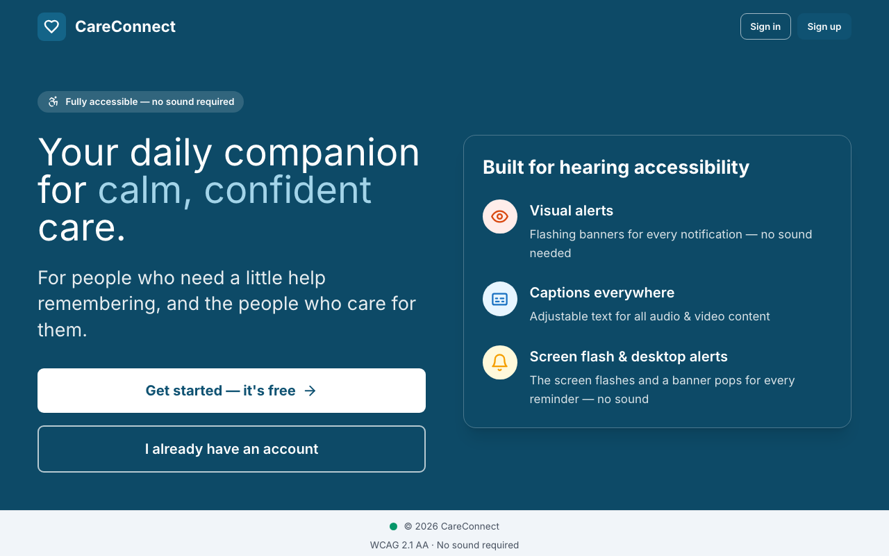

### 1. Create an account or sign in

From the welcome page, choose **Sign up** if this is your first visit, or **Sign in** if you have been here before.

| Form | What it needs |
|:-----|:--------------|
| **Create your account** | Your name (this is how CareConnect greets you), an email address, a password of at least 6 characters, and the same password again |
| **Welcome back** (sign in) | An email address and any password |

CareConnect is a demonstration, so there is no real account. Any correctly written email address works, such as `you@example.com`. If something is missing, a message at the top of the form and next to the field says what to fix.

### 2. Choose your role

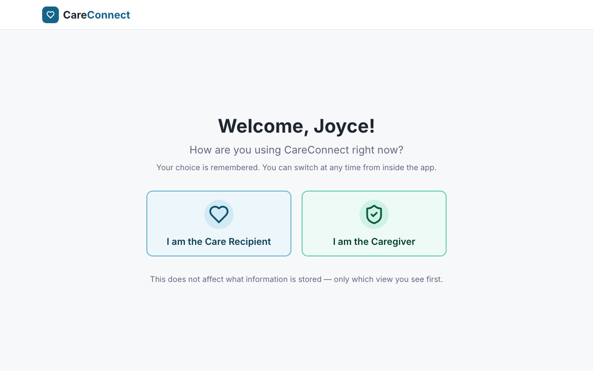

| Choose | If you… |
|:-------|:--------|
| **I am the Care Recipient** | want to see your day, take your medicines, and keep in touch with the people who care for you |
| **I am the Caregiver** | look after someone and want to manage their care plan, check their activity and write shift notes |

You can change role later from the account menu. Both roles share the same care plan on the same device, so a medicine a caregiver adds appears on the care recipient's **Medicines** screen.

---

## Finding your way around

- **Navigation:** on a computer, the screens are listed down the left side. On a phone or a narrow window, open the menu button at the top left.
- **Search:** the search box at the top finds medicines, appointments and people. Press **Ctrl + K** (**⌘K** on a Mac) to jump straight to it.
- **High contrast:** the **High contrast** button (a half-filled circle) in the header switches to stronger colours and borders. CareConnect remembers your choice.
- **Account menu:** your name at the top right opens a menu with **Switch to caregiver** (or **Switch to care recipient**) and **Sign out**.
- **Keyboard shortcuts:** the keyboard button in the header lists every shortcut. See [Keyboard shortcuts](#keyboard-shortcuts).
- **Status bar:** the bar at the bottom shows **Online · synced just now**. When you lose your connection it shows **Offline · changes will sync when you reconnect**.

---

## For the care recipient

### Home

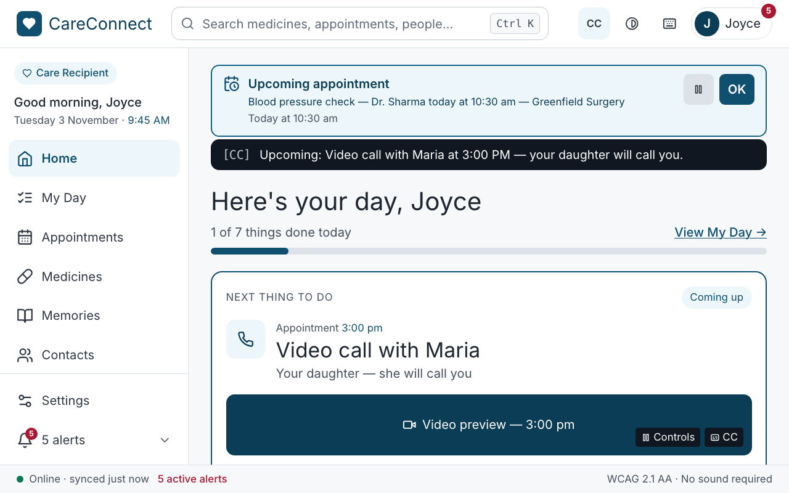

Home greets you (*Here's your day, Margaret*) and shows:

- **Things done today**: how many of today's tasks you have finished.
- **What's next**: your next event, such as a video call or an appointment.
- **Later today**: the rest of the day at a glance.

### My Day

**My Day** is your checklist for today: medicines, check-ins, appointments and routines such as *Wind down for sleep*. Select a task, or press **Space** when it is focused, to tick it off. Select it again to untick it.

### Medicines

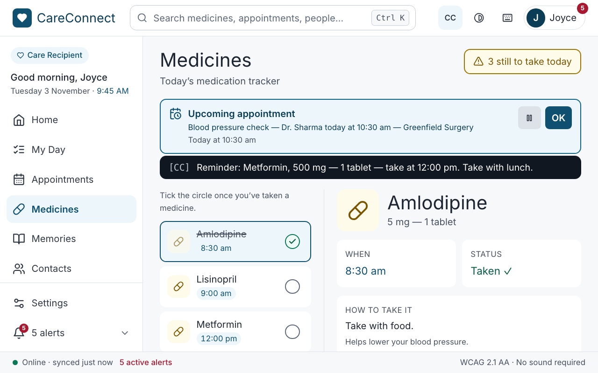

**Medicines** lists what to take today, when, and how to take it. Expand a medicine to read its instructions.

- Tick the box when you have taken a medicine. It changes to **Taken ✓** and a message confirms *Medicine taken*.
- Ticked by mistake? Select it again (**Taken — tap to undo**) to unmark it.
- When everything is done, the screen says **All taken today**.

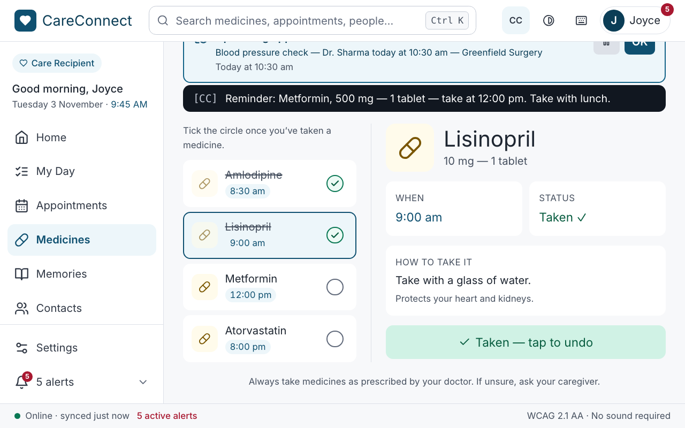

Tomorrow the ticks clear, ready for a new day.

### Appointments

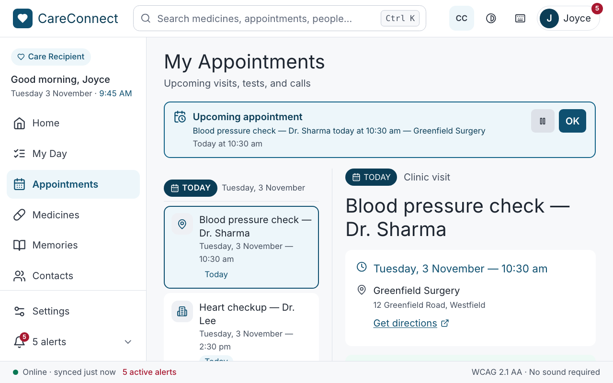

**My Appointments** groups your visits into **Today**, **Later this week** and **Coming up**. Each one says where it is (for example *Telephone — no travel needed*, or *Home visit — they come to you*), when it is, and any notes from your caregiver.

- **Add to My Day** puts an appointment on today's checklist. It then shows **In My Day**.
- **Export to calendar** saves your visits as a file called `careconnect-appointments.ics`. Open that file from your downloads to add the visits to Outlook, Apple Calendar or Google Calendar. If an appointment has no date a calendar can read, CareConnect tells you which ones were left out.
- Before an appointment, a banner reminds you. Choose **OK** to dismiss it.

### Memories

**Memories** is your memory book of special moments.

- Use the filters at the top (**All**, **Family**, **Pets**, **Places**, **Hobbies** and so on) to show one kind of memory.
- **Add a memory:** give it a name (for example *Our wedding day*), write the memory, and optionally say when it happened (for example *Summer 1975*).
- **Pin to top** keeps a favourite memory first.
- **Remove memory** asks you to confirm, because a removed memory can't be brought back.

### Contacts and messages

**Contacts** lists *People who care for you*. Type in **Find a contact** (or press **/** to jump there) to search by name, relationship or role.

Select a person to open your conversation with them:

- **Type a message** and choose **Send**. To save typing, open **Quick replies** and choose one: it fills in the message box, ready for you to send or change.
- **Alert** sends that person a silent screen flash, and a vibration if their phone has it on. It never makes a sound. A message confirms: *Alert sent to Maria. Their screen flashed and their phone buzzed.*
- **Video call** asks for a video call with live captions. CareConnect confirms the request in writing.
- When someone calls you, an **INCOMING VIDEO CALL** banner appears with **Answer** and **Decline**. During the call, captions and a **Transcript** show everything that is said, and you can change the call volume or pause the sound.

Press **Esc** to leave a conversation.

---

## How CareConnect alerts you

CareConnect never relies on sound. Every alert always appears on screen as words. Depending on your settings, it can also:

| Alert | Screen flash | Vibration rhythm |
|:------|:-------------|:-----------------|
| **Medication** | Amber flash | Double pulse (`··   ··`) |
| **Appointment** | Teal flash | Long-short-long (`—  ·  —`) |
| **Missed / Escalated** | Rapid red double-flash | Rapid burst (`···· ····`) |

Each alert type has its own colour and rhythm, so you can tell them apart at a glance, or with your phone in a pocket. The alert's name is always written on the flash too.

If you have *reduce motion* turned on in your device's accessibility settings, the flash shows as a steady coloured panel instead of flashing. It still carries the same message.

**Smart alert escalation** is designed to pass missed alerts on to your care team. In this demonstration you can turn the setting on or off, but no escalation is actually sent.

---

## Accessibility Settings

Open **Settings** at the bottom of the navigation. On the desktop app, press **Ctrl + ,** (**⌘ ,** on a Mac). A badge at the top confirms **Hearing-accessibility requirements met**. If you turn captions off, it warns you that some spoken content will have no text.

| Section | Setting | What it does | Starts as |
|:--------|:--------|:-------------|:----------|
| **Visual Alerts** | Visual alert banners | A banner on screen for every notification. **This one can't be turned off**: without it, an alert could reach you by sound alone. | On (fixed) |
| | Smart alert escalation | Passes missed alerts on to your care team (simulated) | On |
| **Captions** | Show captions | Text for all audio and video | On |
| | Caption size | **Small**, **Medium** or **Large** | Medium |
| | Caption colour | **White** or **Yellow**. Both are easy to read on the dark caption panel. | White |
| **Audio** | Alert volume | Volume of the optional sound that comes with an alert. Zero is fine: the banner and vibration still arrive. | 70% |
| | Audio balance | Shifts sound left or right. Useful if you wear one hearing aid. | Centre |
| **Screen Flash & Desktop Alerts** | Screen flash alerts | Flashes the whole screen for every notification. Choose a flash cue to preview it. | On |
| | Desktop notifications | Shows a notification even when CareConnect is in the background. Your browser asks for permission the first time. | Off |
| | Alert my connected devices | Also flashes a smart light and notifies your phone and watch (simulated) | Off |
| **Vibration** | Vibration alerts | Vibrates your phone for every notification | On |
| | Vibration patterns | Choose **Play** to feel a rhythm on a phone. On a computer, a lamp pulses in the same rhythm instead. | — |

Changes take effect immediately. There is no Save button.

> **Vibration on the web app** works in Chrome on Android. iPhones and iPads don't let websites vibrate, and computers have no vibration motor, so on those the flash and banner do the job.

---

## For the caregiver

Choose **I am the Caregiver** when you sign in, or **Switch to caregiver** from the account menu.

### Dashboard

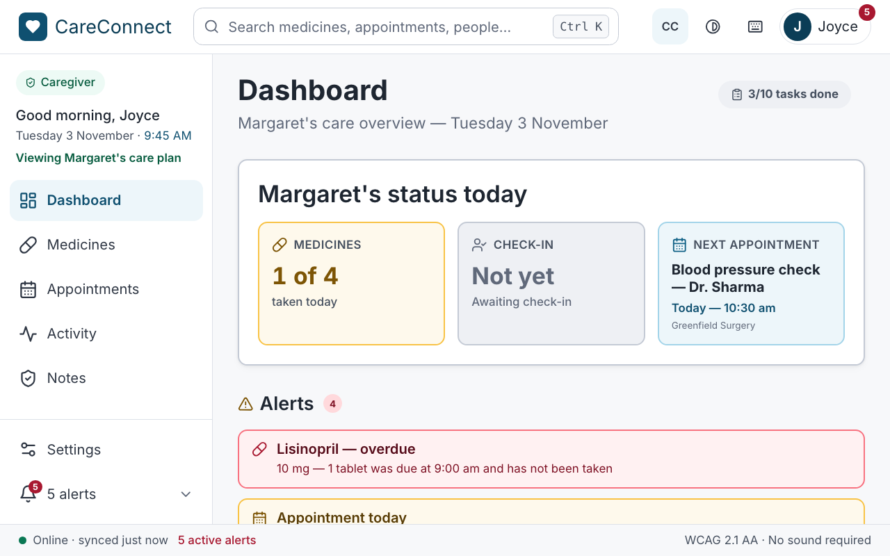

The dashboard shows:

- **Alerts**: overdue medicines and appointments coming up soon.
- **Recent activity**: what the care recipient has done today. Choose **View all activity** for the full log.
- **Quick links** to the caregiver screens.

### Medicines

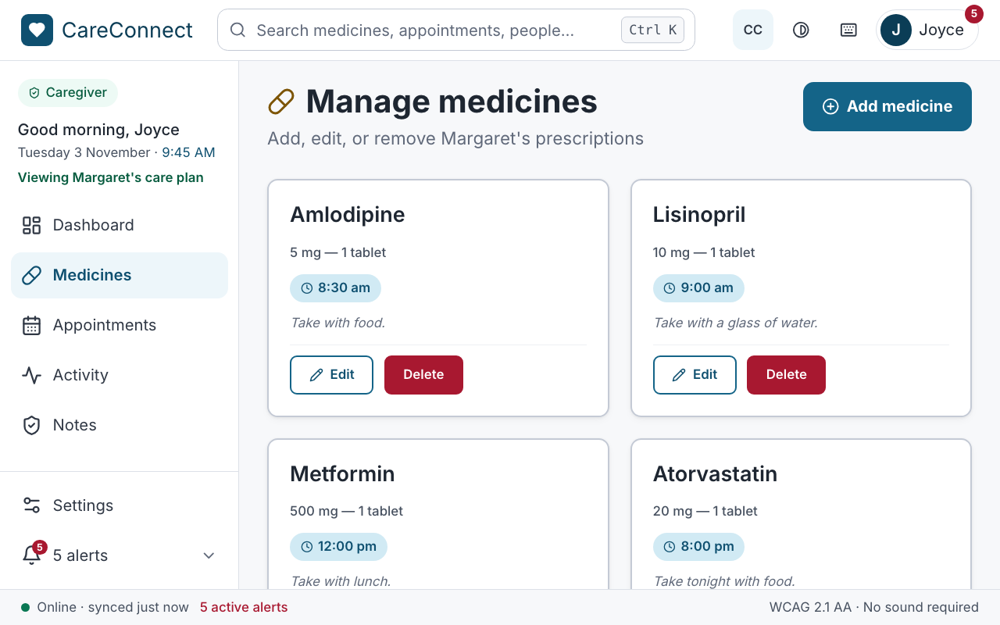

The caregiver's **Medicines** screen manages the care plan:

- **Add medicine** opens a form for the name, the dosage (strength, form and quantity), one or more **Scheduled times**, and optional plain-language instructions. Those instructions appear on the care recipient's Medicines screen.
- Edit a medicine, or **Delete medicine** (you are asked to confirm with **Yes, delete**).
- See which medicines are **Taken ✓** and which are **Not taken yet** today.

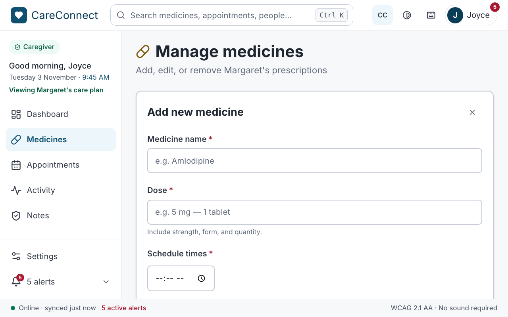

The form says which fields are required, such as *Medicine name is required.*, before it saves.

### Appointments

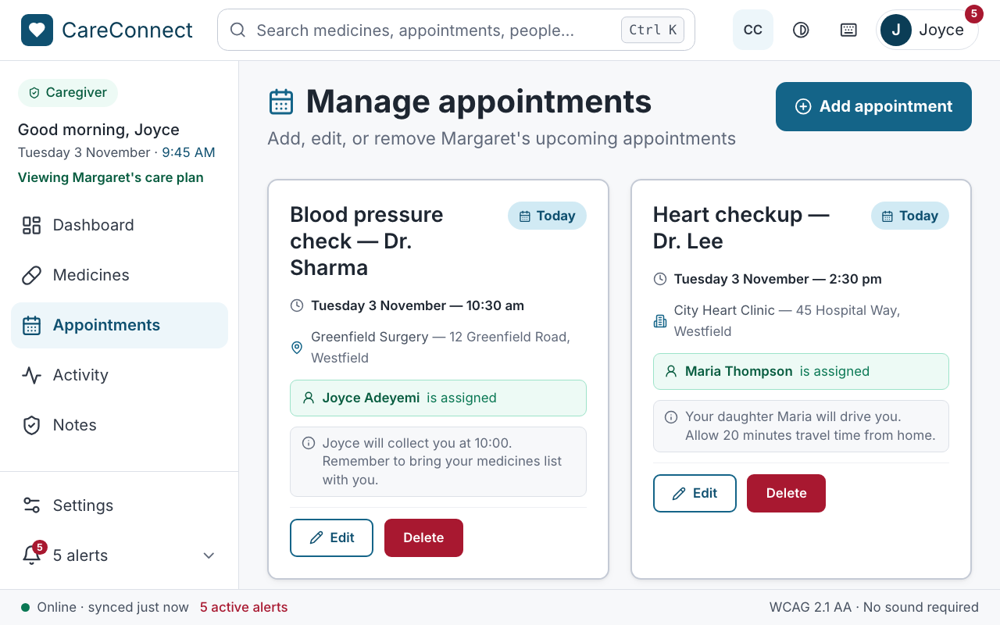

**Add appointment** records the title, date, time, location type (clinic visit, hospital visit, home visit or telephone), location name and address, the assigned caregiver, and optional notes in plain language for the care recipient. Edit or delete appointments here as well.

### Activity

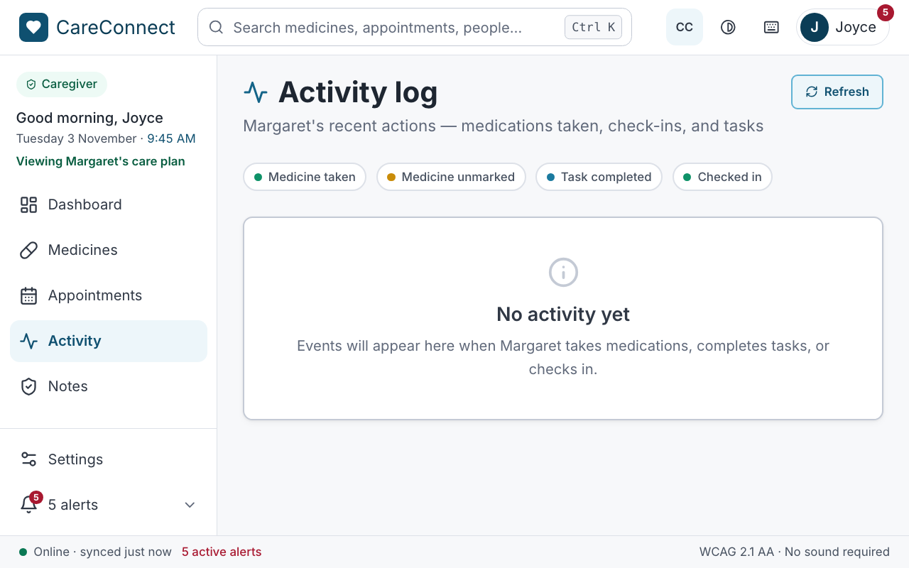

**Activity** is a timeline of the care recipient's day: medicines taken or unmarked, tasks completed, check-ins and more. A legend explains the activity types. Use **Refresh activity log** to bring it up to date.

### Notes

**Notes** holds shift notes for the care team. Choose **Add a new caregiver note**, describe any observations, concerns or updates, mark it **Routine**, **Note** or **Urgent**, and save. Notes are grouped by day, newest first.

> New notes last only until you reload the page or close the app. They are not saved yet.

---

## Keyboard shortcuts

Everything in CareConnect can be done with a keyboard. **Tab** moves to the next button or link, and **Shift + Tab** moves back.

### Web app

| Keys | What it does |
|:-----|:-------------|
| **Ctrl + K** (⌘K on a Mac) | Search medicines, appointments and people |
| **Tab** | Move to the next button or link |
| **Space** | Tick a medicine or a My Day task |
| **/** | On Contacts: jump to *Find a contact* |
| **Esc** | Close a menu or dialog; leave a conversation |

### Desktop app

| What it does | Windows | macOS |
|:-------------|:--------|:------|
| Go to Home … Contacts | **Ctrl + 1** to **6** | **⌘1** to **⌘6** |
| Accessibility Settings | **Ctrl + ,** | **⌘ ,** |
| Back | **Alt + ←** | **⌘ [** |
| Find a contact | **Ctrl + F** | **⌘F** |
| Send message | **Ctrl + Enter** | **⌘ Enter** |
| Alert this contact | **Ctrl + Shift + N** | **⌘ Shift N** |
| Show keyboard shortcuts | **Ctrl + /** | **⌘ /** |

The desktop app's **View** menu also has **Zoom In**, **Zoom Out** and **Actual Size** to make everything larger.

---

## Your data

What CareConnect remembers depends on which version you use:

| Version | What is kept after you close it |
|:--------|:--------------------------------|
| Web app | Your account, role, settings, ticked medicines and tasks, appointments, memories, messages, and the medicines and appointments a caregiver adds. Caregiver **notes** are not kept. Everything is stored **in this browser on this device only**. |
| Android app | Your accessibility settings. Everything else goes back to the sample data when the app is closed. |
| Desktop app | Your sign-in, your chosen role, your accessibility settings, your My Day ticks and the window's size and position. Everything else goes back to the sample data when you quit. |

Nothing is sent to a server. To start again from the sample data on the web app, see [Troubleshooting → Start over](troubleshooting.md#start-over-with-fresh-sample-data).
