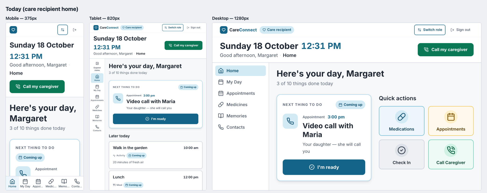
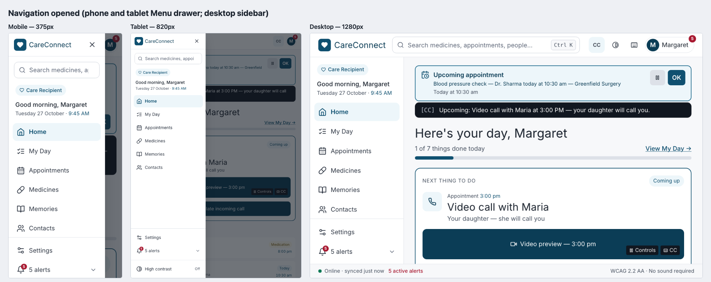
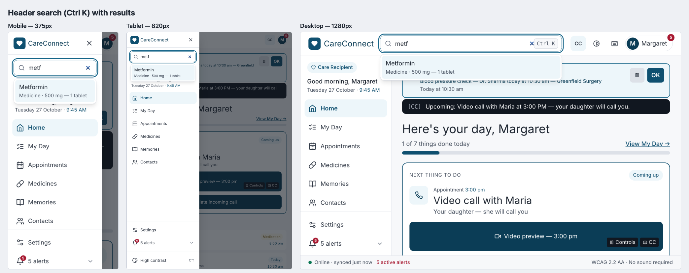
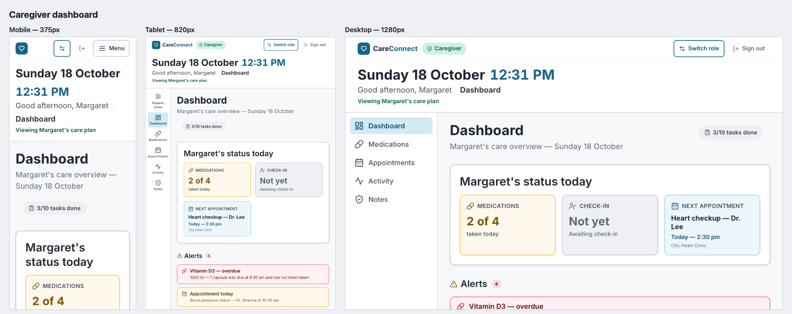
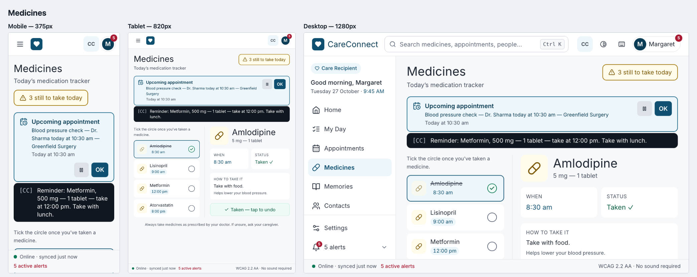
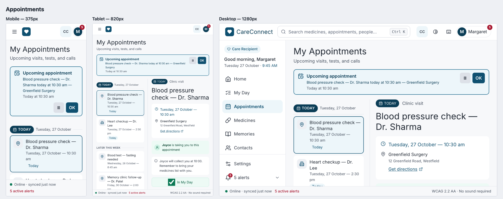
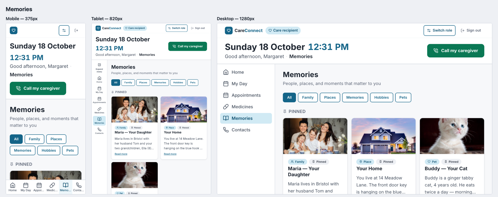
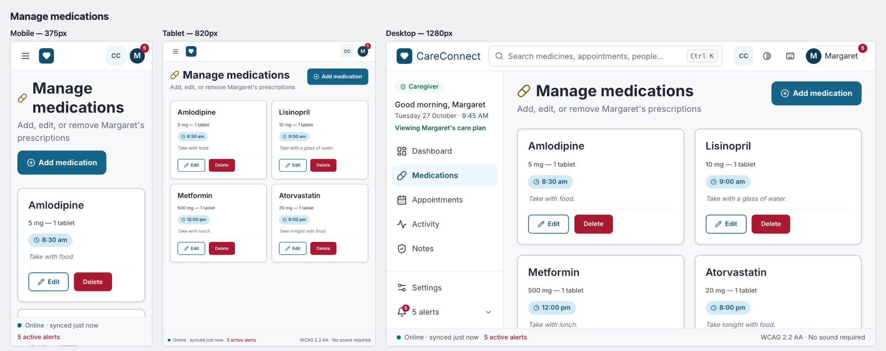

# Early React implementation — CareConnect web app

**SWEN 661 Team 2 (The Acuity Health Group) — Assignment 10, expectation 2 /
Deliverables Part 4.** The React web app at the repository root, extended this
week toward the responsive web design: navigation, layout grid and primary screens
working at the three web breakpoints.

| Evidence | Where |
|:--|:--|
| React source | [`src/`](../../../src) — shell in [`src/components/Layout.tsx`](../../../src/components/Layout.tsx), navigation in [`src/components/navigation/`](../../../src/components/navigation) |
| Install and run | [below](#install-and-run) |
| Screenshots — every screen at all three breakpoints | [`screenshots/overview/`](screenshots/overview) (side by side); [`mobile/`](screenshots/mobile), [`tablet/`](screenshots/tablet), [`desktop/`](screenshots/desktop) |
| Completed work | [§3](#3-completed-this-week) |
| Differences between design and implementation | [§5](#5-differences-to-resolve-with-the-design) |
| Remaining tasks | [§6](#6-remaining-tasks) |

> **Status after Week 11 (27 October 2026).** This page was written for
> Assignment 10. In Week 11 the team finished every screen (see the
> [team overview](../week11/README.md)) and the app shell was rebuilt to the
> Figma web design. That resolved most of the differences in [§5](#5-differences-to-resolve-with-the-design)
> and replaced the navigation described in §2: there is no bottom tab bar
> and no tablet rail any more. Below 1024 px a ☰ **Menu** drawer opens the
> same panel the desktop sidebar shows. The text, tables and every screenshot
> on this page have been updated to the current app; the Assignment 10
> history is kept where it explains a decision.

---

## Install and run

Requirements: Node.js 18 or newer (developed on 24), npm 9 or newer.

```bash
git clone https://github.com/viclee1/careconnect-swen661.git
cd careconnect-swen661          # the web app is the repository root
npm install

npm run dev                     # http://localhost:5173 — hot reload
npm run build && npm run preview  # production build, with the PWA service worker
```

Sign in with **any** well-formed email and password (sign-in is mocked in
`src/auth/mockAuth.ts`), then choose **care recipient** or **caregiver**. The
avatar's account menu (top right) has **Switch to caregiver / care recipient**
and **Sign out**. Data is mock data kept in
`localStorage`; nothing leaves the browser.

| Command | Does |
|:--|:--|
| `npm test` | Jest + React Testing Library — 375 tests in 29 suites |
| `npm run test:e2e` | Playwright against the production build (Chromium, Firefox, WebKit, mobile Safari) |
| `npm run typecheck`, `npm run lint` | TypeScript and ESLint |
| `npm run a11y:web` | axe-core and keyboard checks at 375 / 820 / 1280px (needs `npm run dev -- --port 5180` running, and `npx playwright install chromium` once) |
| `npm run screenshots:responsive` | Regenerates every screenshot in this folder (same dev server) |

**Stack:** React 18 + TypeScript, Vite 5, React Router 7, Tailwind CSS 3
(design tokens in `tailwind.config.js`), lucide-react icons, Jest. PWA manifest
(`public/manifest.webmanifest`) and service worker (`public/sw.js`) are in place.

---

## 1. Application structure

```
src/
├── App.tsx                 routes: public (/, /signin, /signup), /role, and /app/* behind ProtectedRoute
├── components/
│   ├── Layout.tsx          app shell: skip link, header, <main>, sidebar or drawer, status bar
│   ├── navigation/
│   │   ├── navItems.ts     one link list per role, shared by every navigation surface
│   │   ├── NavPanel.tsx    role, greeting, date and time, pages, Settings and alerts
│   │   ├── SideNav.tsx     desktop sidebar (1024px+), renders NavPanel
│   │   ├── NavDrawer.tsx   phone and tablet Menu drawer (modal), renders NavPanel
│   │   ├── AppSearch.tsx   header search (Ctrl/⌘ K), an ARIA combobox
│   │   ├── AccountMenu.tsx avatar + alerts badge; Switch role, Sign out
│   │   ├── ShortcutsDialog.tsx, StatusBar.tsx, useAlerts.ts
│   ├── AppointmentBanner, CaptionStrip   visual alert and [CC] strip, following Settings
│   ├── Button, Card, Field, Banner, BigActionTile, ConfirmDialog, InstallPrompt
│   ├── appointments/, medicines/, memories/, contacts/, messaging/, settings/
├── pages/                  15 screens (below)
├── hooks/                  useDocumentTitle, useLocalStorageState, useOnlineStatus, useMediaQuery,
│                           useFocusTrap, useHighContrast
├── context/                Appointments, Medicines, Memories, Messages, Settings providers (Context API)
├── index.css               base styles, focus ring, .page-container and .card-grid layout primitives
└── auth/, context/, data/  mock auth, app state, mock data stores
```

| Area | Screens (route) |
|:--|:--|
| Public | Landing `/`, Sign in `/signin`, Sign up `/signup`, Role chooser `/role` |
| Care recipient | Home `/app`, My Day `/app/my-day`, Appointments `/app/appointments`, Medicines `/app/medicines`, Memories `/app/memories`, Contacts `/app/contacts`, Conversation `/app/contacts/:id`, Accessibility Settings `/app/settings` |
| Caregiver | Dashboard `/app`, Manage medicines `/app/manage-medicines`, Manage appointments `/app/manage-appointments`, Activity log `/app/activity`, Notes `/app/caregiver` |

Primary workflows that work end to end: sign up / sign in → choose a role; mark
today's medicines and tasks done (and undo); add an appointment to My Day; check in;
caregiver adds, edits and deletes medications and appointments (deletion confirmed
in a dialog); caregiver writes a prioritised note; switch role; sign out.

---

## 2. Responsive behaviour

Breakpoints (`tailwind.config.js`), matching the web design spec:

| | Mobile 320–767px | Tablet 768–1023px (`md`) | Desktop 1024px+ (`lg`) |
|:--|:--|:--|:--|
| Navigation (both roles) | ☰ **Menu** opens a drawer from the left: role, greeting, date and time, pages, Settings, alerts, search and high contrast | Same drawer | **Sidebar** with the same panel; Settings and the alerts list at its foot |
| Header (68px, sticky) | Menu, logo, CC, avatar with the alerts badge | Same | Logo and name, **search** (Ctrl K), CC, high contrast, keyboard shortcuts, avatar with first name |
| Page grid | Single column; Medicines and Appointments show the list, then the detail | List beside detail (15–18rem list column) | Same, wider; Memories one column capped at 56rem |
| Status bar (sticky) | Connection and active alerts | Same, plus "WCAG 2.2 AA · No sound required" | Same |

Checked at 375, 402, 768, 820, 1280 and 1440px: no horizontal scrolling on any
screen, and axe reports no violations (jest-axe on every route at phone and
desktop width; `@axe-core/playwright` on the care pages in three browser
engines).

### Screenshots

Each image shows one screen at mobile (375 × 812), tablet (820 × 1180) and desktop
(1280 × 800), regenerated on 27 October 2026 with the clock fixed at 9:45 am.

**Home (care recipient)** — the appointment banner and [CC] caption, today's
progress, the next thing to do and Later today; Menu on phone and tablet,
sidebar on desktop.



**Navigation opened** — the Menu drawer on phone and tablet; the sidebar on
desktop.



**Search (Ctrl K)** — in the drawer below 1024px, in the header on desktop.



**Caregiver dashboard** — status tiles fit whatever width is available.



**Medicines** — the list, then the detail on a phone; side by side from 768px.



**Appointments** — the grouped list and the chosen visit.



**Memories** — one list of rows at every width.



**Manage medicines**



The other screens: [Landing](screenshots/overview/01-landing.png) ·
[Sign in](screenshots/overview/02-sign-in.png) · [Sign up](screenshots/overview/03-sign-up.png) ·
[Role chooser](screenshots/overview/04-role-chooser.png) · [My Day](screenshots/overview/06-my-day.png) ·
[Contacts](screenshots/overview/10-contacts.png) · [Manage appointments](screenshots/overview/13-manage-appointments.png) ·
[Activity log](screenshots/overview/14-activity.png) · [Notes](screenshots/overview/15-notes.png)

---

## 3. Completed this week

*(Assignment 10. The tablet rail, caregiver Menu panel and bottom tab bar
described here were replaced in Week 11 by the Figma shell above.)*

**Responsive navigation** (`src/components/navigation/`)
- One link list per role (`navItems.ts`), used by all three surfaces, so they can
  never disagree.
- Tablet collapsible sidebar with an accessible toggle (`aria-expanded`,
  `aria-controls`); collapsed is a labelled rail, never icon-only; preference saved.
- Caregiver mobile Menu: disclosure pattern, `Esc` closes and returns focus, closes
  on navigation, positioned so `Tab` goes straight into it.
- `<main>` stays before the navigation in the source at every width; CSS `order`
  places the sidebar on the left.

**Layout system**
- `.page-container` and `.card-grid` in `index.css`, applied to Medicines,
  Appointments, Contacts, Memories and the caregiver pages; dashboard status tiles
  use an auto-fitting grid.
- Fixed a breakpoint bug: the code used `sm:` classes but the config defines only
  `md` and `lg`, so those classes never applied — the header's "Switch role" and
  "Sign out" labels were hidden at every width. They are now `md:`.
- The logo is a router link (it reloaded the whole app before).

**Accessibility, carried through the layout work** (details in
[`../accessibility/`](../accessibility/README.md)): 71 axe violations → 0, page
titles, skip links on every page, focus management on navigation and dialogs,
contrast fixes.

**Tests**: 310 passing, including 54 accessibility and responsive-navigation tests
that simulate mobile and tablet widths.

---

## 4. How the implementation follows the design system

| Design-system element | Implementation |
|:--|:--|
| Colour, type, spacing, radius tokens | `tailwind.config.js` (`calm`, `warm`, `alert`, `success`, `neutral` ramps with measured contrast; 18px base) |
| Buttons (primary / secondary / danger) | `Button.tsx`; danger always confirms |
| Form controls with label, hint, error, required states | `Field.tsx`, `SelectField` |
| Cards | `Card.tsx` (`<section>` + heading level prop) |
| Status / alert banners | `Banner.tsx` (`role="status"` / `alert`) |
| Modal | `ConfirmDialog.tsx` |
| Responsive navigation | `navigation/` (above) |
| Grid | `.page-container`, `.card-grid` |
| Focus state | One 3px `calm-600` ring, `:focus-visible` |
| Selected state | `aria-current="page"` nav links; `aria-pressed` toggles and filters |
| Disabled / error states | `disabled` + `aria-disabled`; `aria-invalid` + inline message |

---

## 5. Differences to resolve with the design

Recorded in Assignment 10 against the web design spec; the **Status** column
is the state after Week 11, checked against the Figma board (*Webpage
design*) at 402, 768 and 1440px.

| # | Area | Spec / design | Assignment 10 | Status after Week 11 |
|--:|:--|:--|:--|:--|
| 1 | Care recipient mobile navigation | Hamburger menu | Always-visible bottom tab bar | **Resolved** — the Figma frames use the hamburger for both roles; the ☰ Menu drawer replaced the tab bar |
| 2 | Mobile header height | — | The orientation bar took about 40% of a 375 × 812 screen | **Resolved** — the 68px Figma header; date and time are in the drawer and sidebar |
| 3 | Mobile tab bar labels | — | Labels truncated ("Appoi…") | **Resolved** — no tab bar; full labels in the drawer |
| 4 | Tablet layout of Today and My Day | Two columns on tablet | Single column | **Resolved** — the Figma tablet frames are single column; matched |
| 5 | Desktop card lists | Multi-column | Two or three columns | **Resolved** — Medicines and Appointments are list + detail and Memories a single list, as in Figma |
| 6 | 12-column grid | Formal 12-column grid | Content grids, max 72rem | Open — layouts match the frames; Figma has no formal column grid to map |
| 7 | Web typography | Separate web type scale | One 18px-base scale | Partly — page titles and body now use the frames' regular weights; the 18px base is kept for readability |
| 8 | Web components | Dropdowns, tooltips, tabs | Not built | Partly — combobox (search), menu (account, quick replies) and dialogs are built; tooltips and tabs are not needed by any frame |
| 9 | Footer | — | Desktop only | **Resolved** — the Figma status bar at every width |
| 10 | Sidebar default on tablet | "Collapsible sidebar" | Starts collapsed | **Resolved** — no tablet sidebar; tablets use the drawer, as in the Figma 768px frames |

---

## 6. Remaining tasks

Done since Assignment 10: Figma alignment (§5), code-split routes
(`React.lazy` for Contacts, Conversation, Settings, Appointments, Medicines and
Memories), offline behaviour (offline message queue, cached memory photos,
connectivity shown in the status bar), and empty states on every list.

Still to do:

- Replace mock auth and `localStorage` data with the real backend (the
  Supabase client is installed).
- Real loading and error states once data is remote.
- Connect My Day and Home to the medicines and appointments stores (they keep
  their own task list today), and show an overdue medicine first in the
  Medicines reminder caption.
- Decide whether the AI assistant (`ChatBot.tsx`) returns: it has not been
  mounted since the Week 11 Landing page.
- Manual VoiceOver and NVDA pass on the main flows; test on real phones and tablets.
