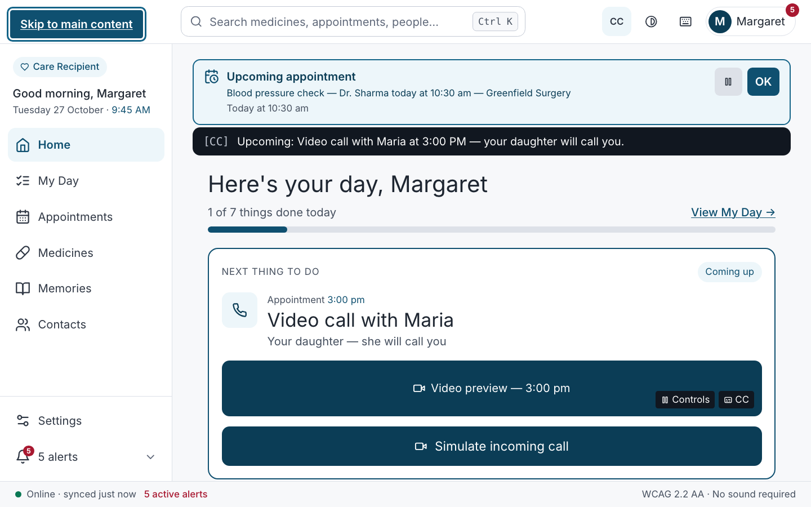
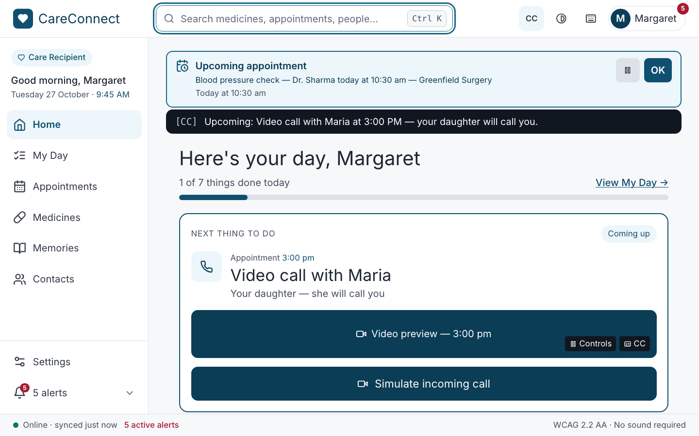
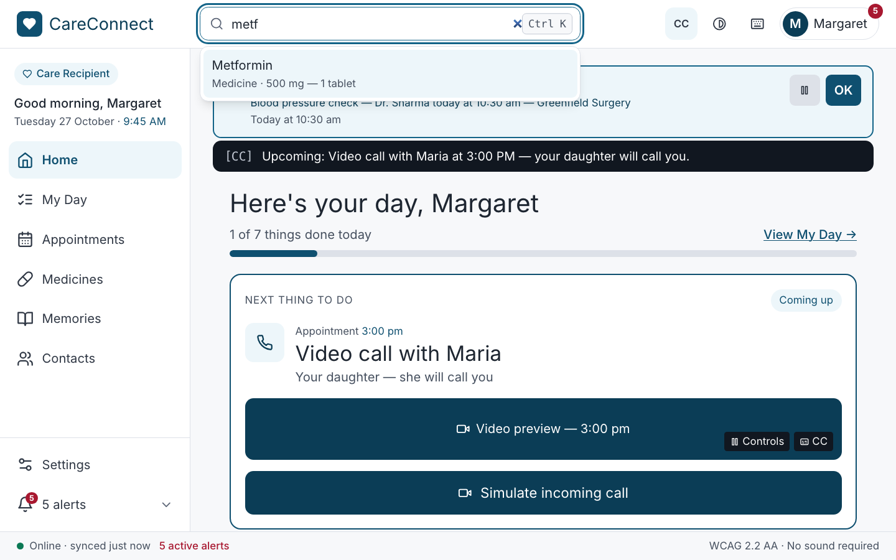
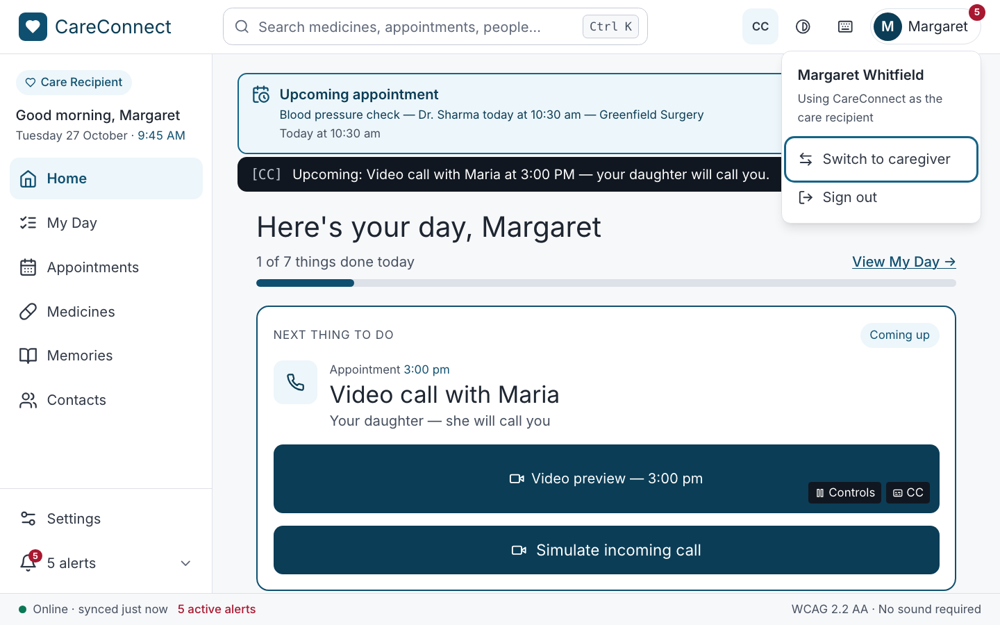
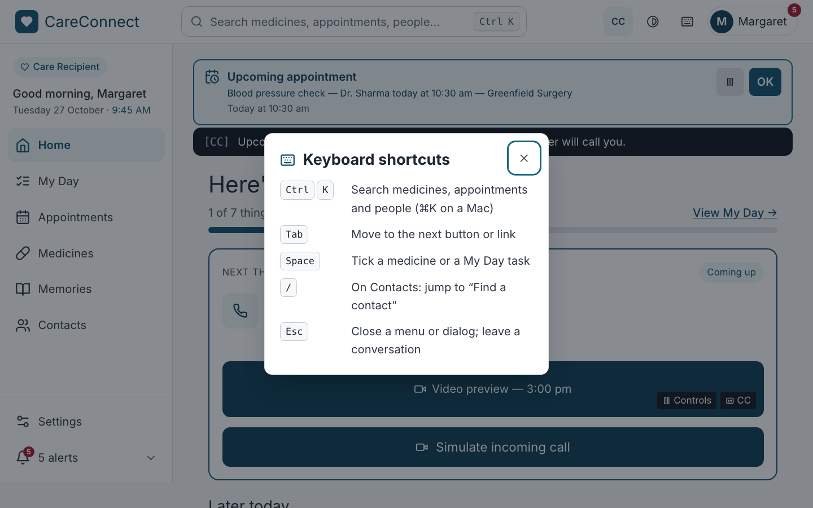
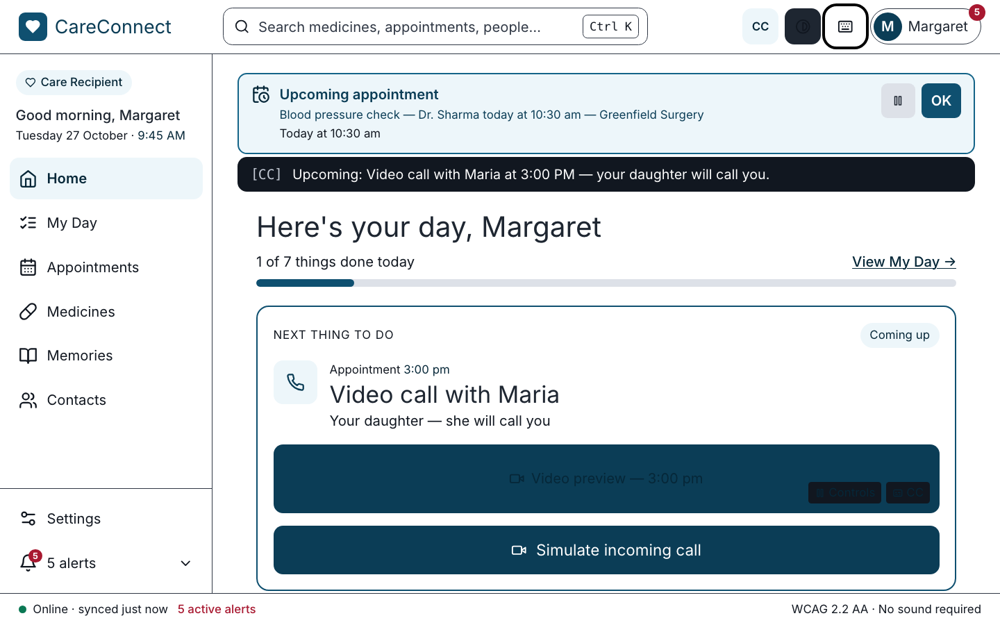
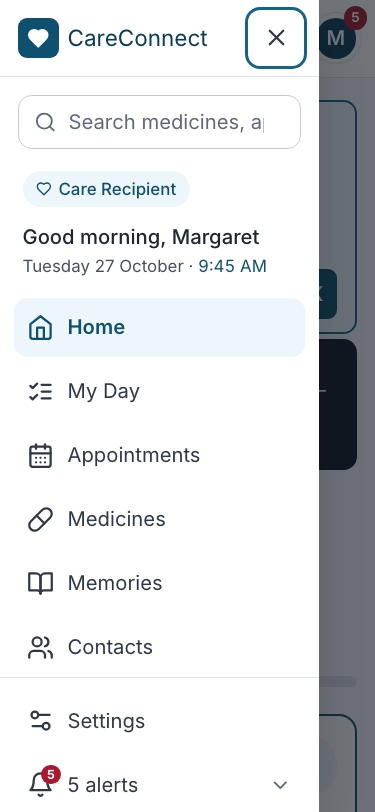
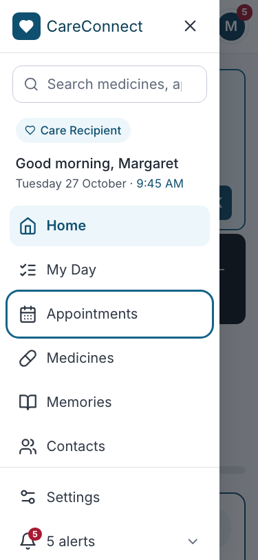
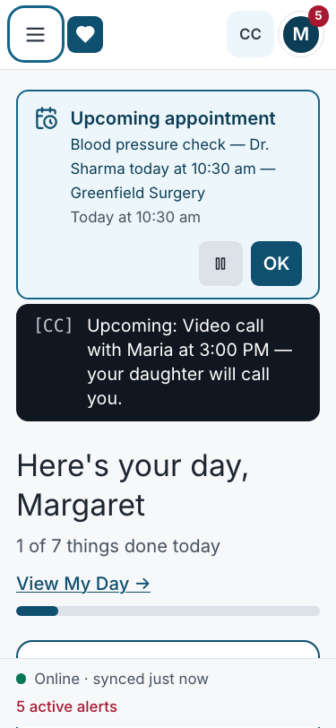
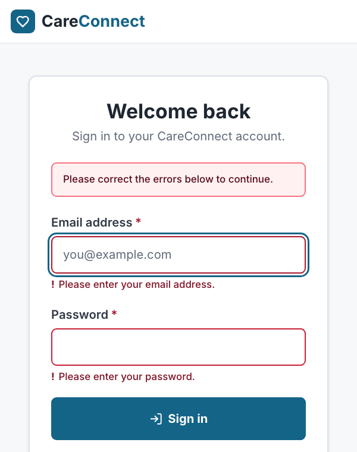

# Accessibility implementation — CareConnect web app (Assignment 11)

**SWEN 661 Team 2 (The Acuity Health Group).** How the whole web app uses
semantic HTML, accessible names and ARIA, how it is operated by keyboard,
how focus is shown and managed, and what keyboard testing found. Written to
be pasted into the team document's *Accessibility implementation* section.
Screen-by-screen detail is in the members' write-ups
([Victor](../victor/README.md#2-accessibility-implementation),
[Upneet](../upneet/README.md#2-accessibility-implementation)); the full
reference, audit history and component rules are in
[`docs/web/accessibility/`](../../accessibility/README.md).

**Results at a glance (27 October 2026):** axe-core finds **0 violations in
64 scans** (17 routes plus open menus, dialogs, search and form errors, at
375, 820 and 1280 px), **53/53** automated keyboard and structure checks
pass, and the 78-test accessibility suite plus every component test passes
(**376 Jest tests**). Every keyboard path below is also driven with real key
presses in Playwright in Chromium, WebKit and mobile Safari.

---

## 1. Semantic HTML

**Rule: use the element that already means the thing; add ARIA only where
HTML has nothing for the job.** A native element brings its role, its
keyboard behaviour and its name rules in every browser and screen reader.

| Need | Native element used | Where |
|:--|:--|:--|
| Page regions | One `<header>` (banner), one `<main id="main-content">`, `<nav aria-label="Main navigation">`, `<footer>` (the status bar) | `Layout.tsx`, every page |
| Headings | Exactly one `<h1>` per page, then `<h2>` sections and `<h3>` items, no skipped levels | Checked on every route by the audit and `structure.md` |
| Going somewhere | `<a href>` / React Router `<Link>`: pages, contacts, alerts, Get directions | Never a `
` |
| Doing something | `<button>`: tick, open, send, alert, pin, dismiss | — |
| Ticking a medicine, adding a visit to My Day, on/off settings | Native `<input type="checkbox">` (switches add `role="switch"`) | Space toggles, state announced by the browser |
| One choice from several | `<fieldset>` + `<legend>` + native radios (caption size and colour, memory filter) | Arrow keys and "2 of 3" come free |
| Volume and balance | `<input type="range">` with `aria-valuetext` in words | Arrow, Home, End, Page keys |
| Forms | `<form noValidate>`, a visible `<label for>` on every field, `<select>`, `<textarea>`, `autocomplete` | Sign in, Sign up, Add a memory, message composer, caregiver forms |
| Lists | `<ul role="list">` (Safari drops list semantics when bullets are removed) | Navigation, medicines, visits, contacts, messages |
| Dates and times | `<time datetime>` | Sidebar clock, visits, schedule |
| A visit or memory | `<article aria-labelledby>` its heading | Appointments detail, memory rows |
| Progress | Native `<progress>` / `role="progressbar"` with the sentence beside it | Medicines, Home |

## 2. Accessible names and labels

- **Every control's name contains its visible words, first** (WCAG 2.5.3), so
  voice-control users can say what they see: "Add to My Day: Blood test",
  "Pin to top: Your Garden", "OK, dismiss the reminder for …", "CC captions".
  The avatar button has no `aria-label` at all — its name is built from its
  own content ("Margaret, account menu, 5 alerts"), with the parts that are
  visually hidden on a phone kept for screen readers.
- **Icon-only controls are named:** "Menu", "Close menu", "High contrast",
  "Keyboard shortcuts", "Dismiss install prompt", "Pause reminder". Every
  decorative icon is `aria-hidden="true"`.
- **Labels are always visible**, never placeholder-only; required fields
  carry `aria-required`; hints and errors are tied to their field with
  `aria-describedby`.
- **Repeated controls are told apart** by adding the item's name to the
  printed word (six "Pin to top" buttons → "Pin to top: Maria — Your
  Daughter", …).
- **Page titles** change with every route ("Medicines — CareConnect").
- **Nothing is sound-only, and nothing is colour-only:** a medicine is taken
  by tick, strike-through **and** the word "Taken"; the connection is the
  words "Online" or "Offline"; an alert is a written banner.

## 3. ARIA, only where HTML has no element

| Pattern | ARIA used | Why HTML is not enough |
|:--|:--|:--|
| Header search | `role="combobox"` with `aria-expanded`, `aria-controls`, `aria-activedescendant`, a `role="listbox"` of `role="option"`, `aria-keyshortcuts`; match count in `role="status"` | No native autocomplete list with arrow-key selection |
| Menu drawer, keyboard shortcuts, confirm dialogs | `role="dialog"`, `aria-modal="true"`, `aria-labelledby` (or `aria-label="Menu"`) | `<dialog>` is avoided for one consistent focus-trap implementation (`useFocusTrap`, `ConfirmDialog`) across browsers |
| Account menu, sidebar alerts, Add a memory, Read more | Disclosure: `<button aria-expanded aria-controls>` | States "expanded/collapsed" |
| Quick replies (Messaging) | `aria-haspopup="menu"`, `role="menu"` / `menuitem` | No native menu button |
| CC, high contrast, Pause | `aria-pressed` | Toggle buttons |
| Current page / item shown | `aria-current="page"` on the nav link; `aria-current="true"` on the medicine or visit shown in detail | Marks "you are here" without colour alone |
| Announcements without moving focus | `role="status"` / `aria-live="polite"`: medicine count, search results, "Saved …", message counter, flash alerts; `role="alert"` for form errors | Screen-reader users are told what changed |
| Invalid fields | `aria-invalid="true"` + `aria-describedby` the error | — |
| Visually hidden parts of a name | `.sr-only` text, never `aria-label` on a `` | Screen readers ignore labels on generic elements |

---

## 4. Keyboard operation

Everything is reachable and operable from the keyboard; nothing needs a
mouse, a pointer gesture or sound.

| Key | What it does |
|:--|:--|
| **Tab / Shift+Tab** | Moves forward / back in reading order: **skip link** → header (Menu on phones, logo, search, CC, high contrast, shortcuts, avatar) → page content → sidebar navigation → status bar. `<main>` comes before the sidebar in the source, so content is reached first |
| **Enter** | Follows a link; presses a button; opens the focused visit, medicine or contact; submits a form from a single-line field; in search, opens the highlighted match |
| **Space** | Presses a button; ticks a medicine or My Day task; toggles a switch or checkbox |
| **Escape** | Closes the Menu drawer, account menu, shortcuts dialog, confirm dialogs and Quick replies — **returning focus to the control that opened it**; dismisses the install banner while focus is in it; clears search; closes the Add a memory form keeping the draft; on a conversation, returns to Contacts (not while typing) |
| **Arrow keys** | Move through search matches, radio groups (caption size and colour, memory filter), sliders, Quick replies; scroll the conversation history |
| **Ctrl/⌘+K** | Search: the header field on desktop; below 1024 px opens the Menu drawer with its search focused |
| **Ctrl/⌘+Enter** | Sends a message from the composer (Enter alone starts a new line) |
| **/** | On Contacts, jumps to "Find a contact" (not while typing) — the one single-character shortcut, listed as a known gap below |

## 5. Visible focus

- **One focus ring everywhere:** `*:focus-visible { outline: 3px solid
  #146488; outline-offset: 3px }` — 6.5:1 against white, shown for keyboard
  focus and never removed. In **high-contrast mode** it becomes a 4 px black
  ring.
- **Custom-drawn controls carry the ring explicitly:** switch tracks and the
  round medicine tick (`peer-focus-visible:outline`), radio pills, and the My
  Day button (`has-[:focus-visible]:outline`, around the whole control).
- **Focus is never hidden** under the sticky header or status bar (WCAG
  2.4.11): both heights are measured into CSS, which sets
  `scroll-padding-top` and `scroll-padding-bottom`.
- **Fixed this week:** six text-field styles (the shared `Field` component,
  the contact search, the message composer and three caregiver forms) had
  `focus:outline-none`, which overrode the global ring and left only a
  slightly darker border — invisible on a field already red with an error.
  The override was removed; every text field now shows the 3 px ring.

## 6. Focus management

| Component | Opens | While open | Closes |
|:--|:--|:--|:--|
| **Page navigation** | — | — | After any in-app navigation focus moves to `<main>`, so a screen reader announces the new page and Tab continues from its content (not on first load, so the skip link stays first) |
| **Menu drawer** (below 1024 px) | Focus moves to Close (or to search when opened by Ctrl+K) | Tab and Shift+Tab wrap inside; page behind is dimmed and not scrollable | Escape, Close or following a link; focus returns to ☰ Menu |
| **Account menu** | Disclosure below the avatar | Tab reaches Switch role and Sign out | Escape returns focus to the avatar; a click outside closes it |
| **Keyboard shortcuts, confirm dialogs** | Focus moves into the dialog | Focus trapped | Escape or Cancel; focus returns to the trigger |
| **Search** | Ctrl+K or Tab | Arrow keys move the active option (`aria-activedescendant`), focus stays in the field | Enter opens the page; Escape clears |
| **Forms** | Add a memory: focus to the first field | — | **A refused submit moves focus to the first field to fix**, with the error read from `aria-describedby` (Add a memory, Sign in, Sign up — the last two **fixed this week**); a successful save moves focus to the new memory's heading; Escape returns focus to Add a memory |
| **Lists that change under the user** | — | Ticking a medicine or My Day keeps focus on the control; pinning a memory moves the card and focus follows its button; removing one returns focus to Add a memory | — |
| **Banners** | The install banner and alert banners never take focus | Announced through live regions | Dismiss returns focus to where it was (Export banner → Export button) |

---

## 7. Keyboard testing results

**Method.** Every path in §4 and §6 is automated with real key presses:
Playwright (`e2e/*.spec.ts`) in Chromium, WebKit and mobile Safari, and React
Testing Library with `user-event` in Jest. The automated audit
(`npm run a11y:web`) also tabs through each modal, checks Tab stays inside
the drawer at phone and tablet width and Escape returns focus, and checks
the skip link is the first stop on every shell. The screenshots were taken
from real key presses by `scripts/week11-victor-evidence.mjs` and
`scripts/week11-upneet-evidence.mjs`.

**Results.** All keyboard checks pass — **53/53** in the audit, and every
keyboard test in Jest and Playwright. Two issues were found and fixed while
testing this week: text fields with no visible focus ring (§5) and sign-in /
sign-up forms that left focus on the button after an error (§6).

**App shell and forms**

| | |
|:--|:--|
|  The first Tab shows **Skip to main content** |  Tab reaches the header search |
|  Typing and ↓ highlight a match; Enter opens it |  Enter opens the account menu; Tab reaches **Switch to caregiver** |
|  Escape closes it; focus is back on the avatar |  Enter on the keyboard button opens the shortcuts dialog; focus is inside |
|  High contrast on: the focus ring turns black |  Phone: Enter on Menu opens the drawer, focus on Close |
|  Tab moves through the drawer to a page |  Escape closes it; focus is back on Menu |
|  A refused sign-in: focus on the first field to fix, with the ring | |

**Screens** — Victor's and Upneet's write-ups show each step in full:
Contacts ("/" to search, Tab to a contact, Enter opens it), Messaging (Alert,
Quick replies by arrows, Ctrl+Enter sends), Settings (switches, radio arrows,
the Sign out dialog and Escape), Medicines (Tab to a row and its tick, Space
ticks), Appointments (Space adds to My Day, Export), Memories (filter by
arrows, the form, Escape keeps the draft, a refused save focuses the field,
focus follows Pin).

**Browser differences found.** Safari on macOS skips checkboxes, radios and
some buttons on Tab unless *Full Keyboard Access* is turned on in System
Settings — a platform setting, not an app defect; the WebKit tests focus
those controls directly. Chrome does not support Home/End in a native radio
group (arrows only).

**Still to do.** A manual pass with VoiceOver (Safari, macOS and iOS) and
NVDA (Windows), and a manual keyboard pass in Safari with Full Keyboard
Access, by each member before submission. Known gap: "/" on Contacts is a
single-character shortcut that cannot be turned off (WCAG 2.1.4); planned fix
in [`docs/web/accessibility/README.md` §9](../../accessibility/README.md#9-known-gaps-and-next-steps).
