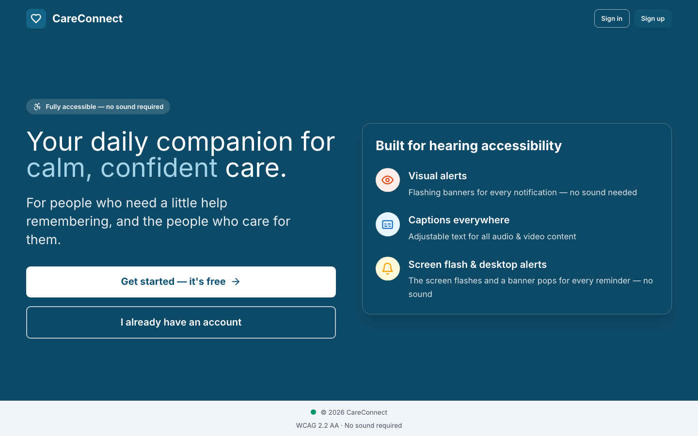
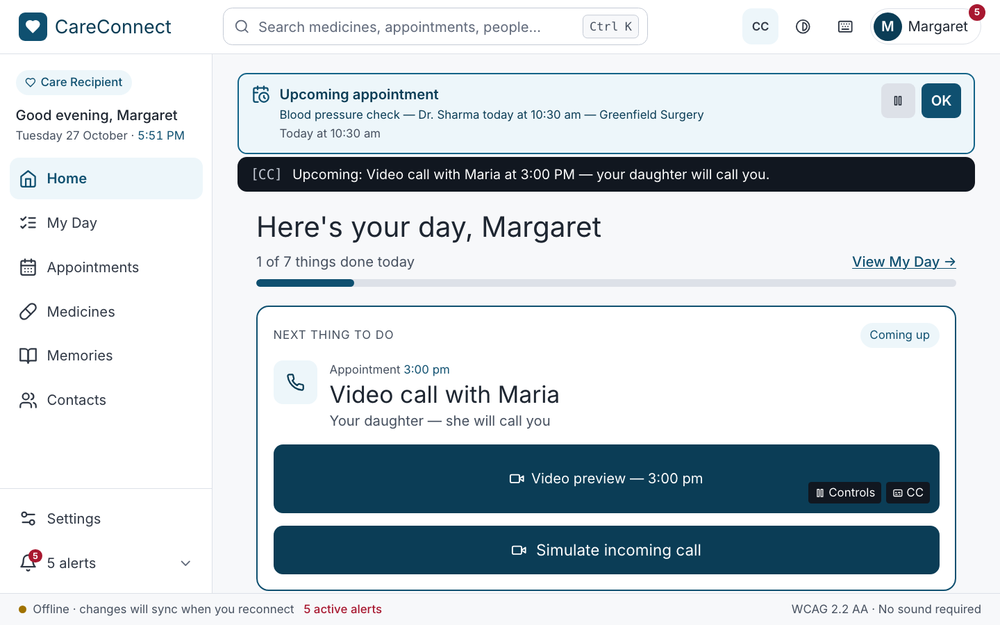
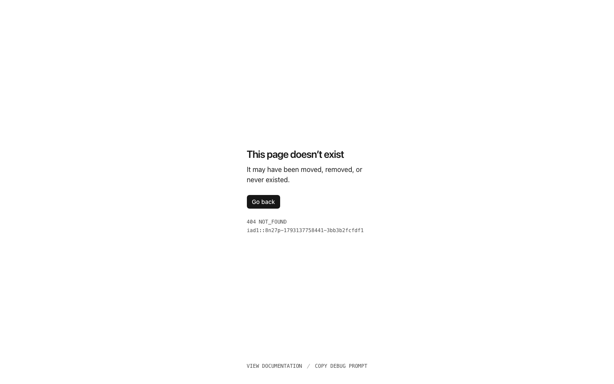

# CareConnect in production

**Live application:** <https://careconnect-swen661.vercel.app/>

The React web app is deployed on Vercel from the repository root
(`npm run build` → `dist/`), served over HTTPS with HSTS. Every push to the
repository gets a Vercel preview build; `main` is production.



*The landing page at <https://careconnect-swen661.vercel.app/>, captured
from the live site at 1440 px on 27 October 2026.*



*The same deployment with the network switched off: Home, today's schedule
and the alerts still render from the service worker's cache, and the status
bar reads "Offline · changes will sync when you reconnect".*

---

## How it was verified

Everything below was run against the live URL, not a local build, with
[`scripts/verify-production.mjs`](../../../../scripts/verify-production.mjs)
(Playwright + Chromium):

```bash
node scripts/verify-production.mjs                  # production
PROD_URL=https://<preview>.vercel.app node scripts/verify-production.mjs
```

1. **HTTP checks.** The script fetches `/`, `/manifest.webmanifest`, `/sw.js`
   and the icons and checks each status code and content type
   (`application/manifest+json`, `application/javascript`, `image/png`).
   It also checks that the site is HTTPS with a `Strict-Transport-Security`
   header, and that `sw.js` is sent with `max-age=0` so a new deploy reaches
   installed users.
2. **Manifest.** In the browser, it reads the `<link rel="manifest">`, then
   checks `name`, `display: standalone`, `start_url: /app`, `scope: /`, and the
   192 px and 512 px maskable icons. It fetches every icon listed.
3. **Service worker.** It waits for `navigator.serviceWorker.ready`, checks
   that the worker is active with scope `/`, reloads, and checks that
   `navigator.serviceWorker.controller` is set (the page is now served
   through the worker). It then lists Cache Storage:
   `careconnect-shell-v1` and `careconnect-runtime-v1` held 17 entries
   (the shell, hashed JS/CSS, icons, the manifest).
4. **Offline.** Playwright switches the browser context offline and reloads.
   Home and "Next thing to do" still render, and the status bar reports
   offline (screenshot above).
5. **Installability.** The script asks Chromium directly through the DevTools
   Protocol (`Page.getInstallabilityErrors`, `Page.getAppManifest`). Chrome uses
   this same check to decide whether to offer **Install**. The live site
   returned no installability errors and no manifest errors. The in-app
   install prompt (keyboard operable, Escape to dismiss) is covered by
   `scripts/verify-pwa.mjs`.
6. **No uncaught errors** on any page the script visited.

### Result on 27 October 2026: 23 passed, 4 failed

| Check | Result |
|:--|:--|
| HTTPS + HSTS, manifest, icons, `sw.js` served correctly | ✅ |
| Manifest fields (standalone, start_url, scope, maskable icons) | ✅ |
| Chromium installability: no errors | ✅ |
| Service worker active, controlling the page, caches populated | ✅ |
| Offline reload shows Home and today's schedule | ✅ |
| **`GET /app`, `/app/contacts`, `/app/settings` and opening `start_url` while online** | ❌ **404 NOT_FOUND** |



**What was wrong.** The app is a single-page app: only `index.html` exists, and
React Router handles `/app/...` in the browser. Vercel had no rewrite rule,
so any URL other than `/` returned Vercel's 404 page. Clicking links inside
the app worked, but a refresh, a bookmark, a shared link, and the installed
PWA itself (its `start_url` is `/app`) did not. Offline it worked, because the
service worker answers navigations from its cached shell. That made the bug
easy to miss in testing.

**The fix.** [`vercel.json`](../../../../vercel.json) rewrites every path that
isn't a real file to `/index.html`. Vercel serves real files before it applies
rewrites, so `/sw.js`, `/manifest.webmanifest`, `/icons/*` and `/assets/*`
are unaffected. It also pins `sw.js` to `Cache-Control: max-age=0`.
The preview build of the fix deployed successfully. Once it is merged to
`main`, run `node scripts/verify-production.mjs` again; it should report
`ALL PRODUCTION CHECKS PASSED`.
