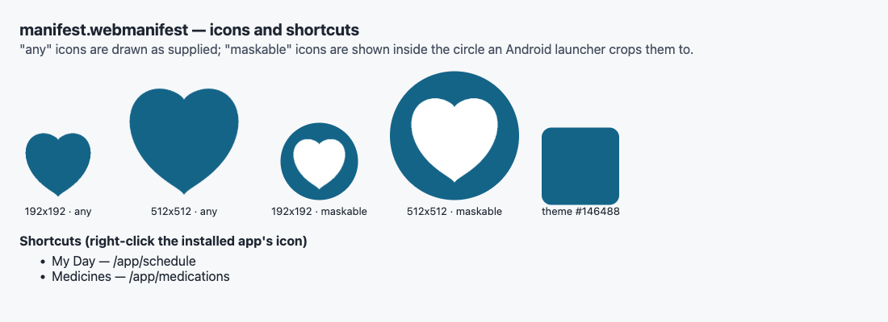
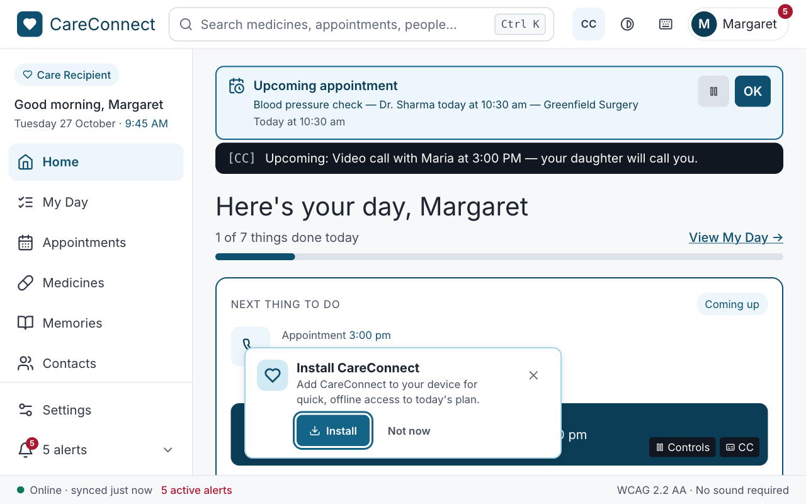
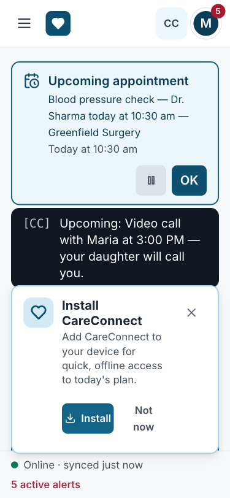
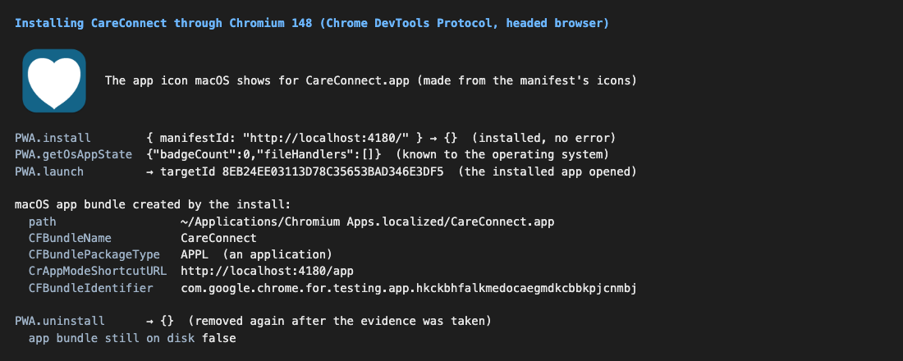
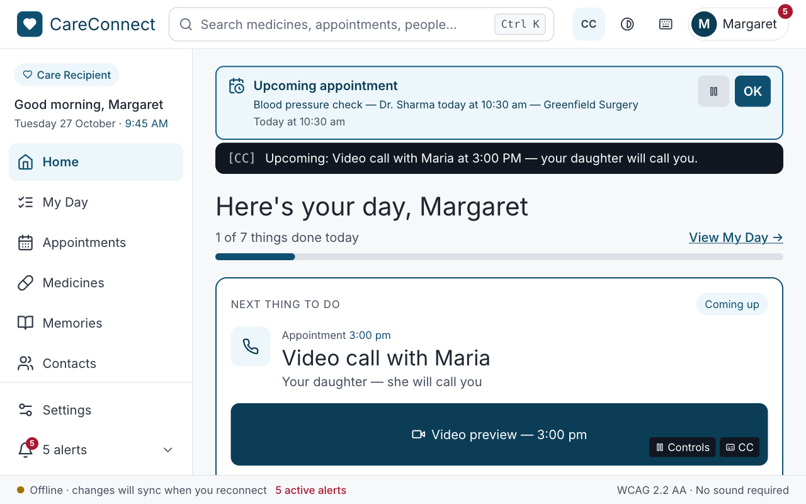
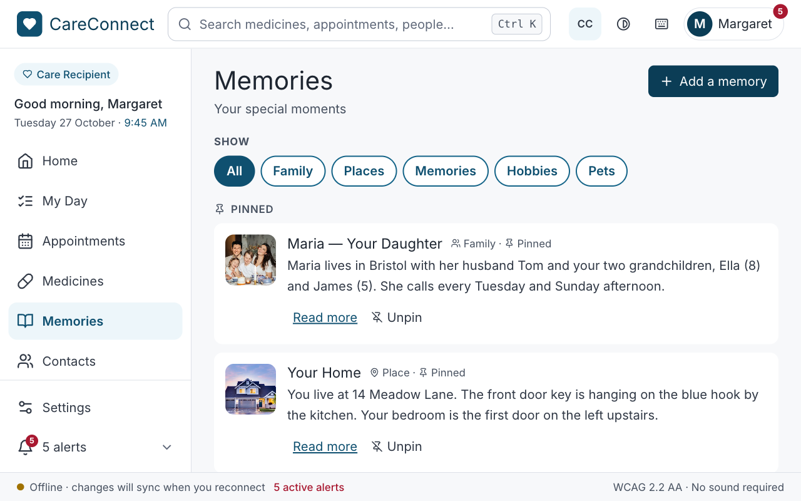
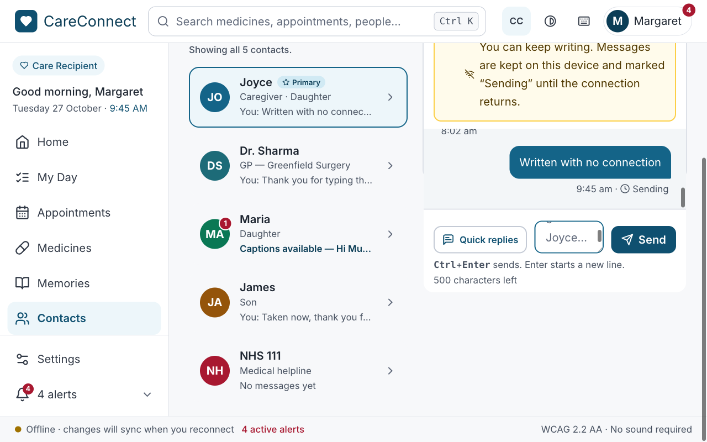
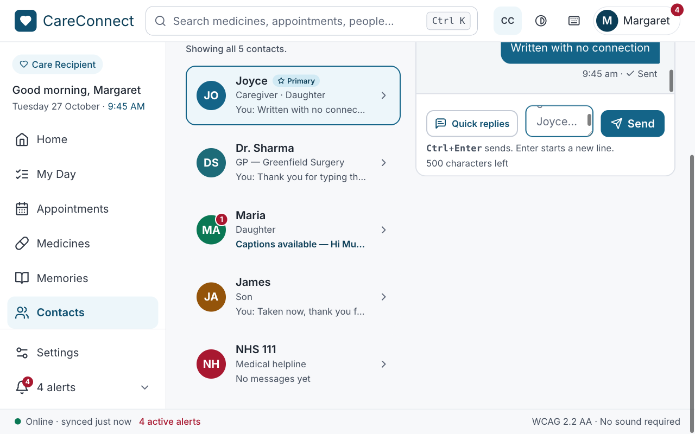

# Progressive Web App — features and evidence

**SWEN 661 Team 2 (The Acuity Health Group), Assignment 11.** What makes the
CareConnect web app a Progressive Web App, how each feature was verified, and
how it installs in each browser. Every screenshot here was made on
27 October 2026 by [`scripts/week11-pwa-evidence.mjs`](../../../../scripts/week11-pwa-evidence.mjs)
against the **production build** (`vite build` + `vite preview`): the service
worker only registers in production builds, so the dev server shows none of
this.

| Evidence | What it shows |
|:--|:--|
| [01-installability.png](screenshots/01-installability.png) | Chrome's own installability check: **no errors**; the parsed manifest; the active service worker and its caches |
| [02-manifest-icons.png](screenshots/02-manifest-icons.png) | The manifest's icons (regular and maskable), theme colour and shortcuts |
| [03-install-banner-desktop.png](screenshots/03-install-banner-desktop.png), [03b-install-banner-mobile.png](screenshots/03b-install-banner-mobile.png) | The app's own accessible "Install CareConnect" banner |
| [04-installed.png](screenshots/04-installed.png) | A real installation through the browser, and the macOS application it created |
| [05-offline-home.png](screenshots/05-offline-home.png) … [08-back-online-sent.png](screenshots/08-back-online-sent.png) | The app working with no connection, and catching up when it returns |

---

## 1. PWA features implemented

| Feature | Implementation | Why it matters for a deaf or hard-of-hearing user |
|:--|:--|:--|
| **Web app manifest** | [`public/manifest.webmanifest`](../../../../public/manifest.webmanifest), linked from `index.html`: `name`/`short_name` "CareConnect", `id` "/", `start_url` "/app", `display` "standalone" (falls back to "minimal-ui"), `theme_color` #146488, `background_color` #f7f8fa, `lang`, `categories` | Installed, it opens straight to the care recipient's Home in its own window, with no browser tabs or address bar to manage |
| **Icons** | SVG, 192 px and 512 px PNG (`purpose: any`) and 192/512 px **maskable** PNGs with the heart inside the safe zone; `apple-touch-icon.png` for iOS (`public/icons/`, generated by `scripts/gen-icons.mjs`) | A recognisable icon on the home screen, dock or taskbar; maskable icons are not clipped by Android's round masks |
| **App shortcuts** | `shortcuts`: **My Day** (`/app/schedule`) and **Medicines** (`/app/medications`) | Long-press or right-click the installed icon to jump straight to today's tasks or medicines |
| **Service worker** | [`public/sw.js`](../../../../public/sw.js), registered after `load` by [`src/pwa/registerSW.ts`](../../../../src/pwa/registerSW.ts) (production builds only) | Makes the app load and work offline |
| **Precaching** | On `install` the worker caches the app shell (`/`, `index.html`, manifest, icons) **and** reads `index.html` to precache the content-hashed JS and CSS it references, so the very first offline visit works | — |
| **Caching strategies** | Page navigations: **network-first**, falling back to the cached shell. Same-origin files (lazy route chunks, CSS, icons, the memory photos): **stale-while-revalidate**. Google Fonts: **cache-first**. Old caches are deleted on `activate`; `skipWaiting` and `clients.claim` put a new version in charge at once | Fresh when online, instant and working when not |
| **Offline data** | Everything the screens show is kept in `localStorage` through `useLocalStorageState` (medicine ticks, My Day, appointments' My Day choices, memories, conversations, settings) — nothing is fetched | The day's plan, medicines and messages are there with no connection |
| **Offline messages** | A message written offline is kept, marked **"Sending"** in words, and sent automatically when the connection returns (`MessagesProvider`) | Nothing the user wrote is lost, and they are told so in writing |
| **Connection status** | The status bar says **"Online · synced just now"** or **"Offline · changes will sync when you reconnect"** (`useOnlineStatus`, from the browser's `online`/`offline` events) | The state is a sentence, not an icon or a sound |
| **Install banner** | [`src/components/InstallPrompt.tsx`](../../../../src/components/InstallPrompt.tsx): catches Chromium's `beforeinstallprompt`, suppresses the default mini-infobar, and shows its own banner; **Install** calls the browser's `prompt()`; **Not now** or ✕ snoozes it for 14 days; hidden once running installed (`display-mode: standalone`, or iOS `navigator.standalone`) and on browsers without the event | Accessible: a labelled region (`aria-labelledby`, polite live region), real buttons, Escape dismisses, never steals focus |
| **Installed-app check** | `appinstalled` hides the banner | — |

---

## 2. Evidence

### 2.1 Installability, as Chrome reports it

![Chrome DevTools Protocol: installability errors [], manifest, service worker active, caches](screenshots/01-installability.png)

The script opens the production build in Chromium 148 (a normal profile),
lets the service worker take control, and asks Chrome through the DevTools
Protocol — the same checks the Application panel in DevTools runs:

- `Page.getInstallabilityErrors` returns **`[]`: Chrome considers the app
  installable.** (In an incognito-style context it returns `in-incognito`,
  because Chrome never offers installs there; the script uses a normal
  profile for this reason.)
- `Page.getAppManifest` parses the manifest with **0 errors**;
  `Page.getAppId` is `http://localhost:4180/`.
- The service worker `sw.js` is **activated** and **controls the page**, and
  Cache Storage holds `careconnect-shell-v1`, `careconnect-runtime-v1` and
  `careconnect-fonts-v1`.

`scripts/verify-pwa.mjs` repeats the essentials as pass/fail checks
(manifest linked and valid, standalone display, maskable and 512 px icons,
theme colour, service worker active, Home renders offline, install banner
appears, is keyboard-focusable and closes with Escape): **11/11 pass**.

### 2.2 Manifest icons and shortcuts



### 2.3 The install banner

| Desktop (1280 px) | Phone (375 px) |
|:--|:--|
|  |  |

Chrome fires `beforeinstallprompt` only after its own user-engagement checks,
which an automated browser session does not pass. To capture the banner, the
script dispatches an event of the same shape (`prompt()`, `userChoice`); from
there the banner's real code runs — it appears, takes no focus, and here
**Install** has been focused with the keyboard to show its focus ring. In a
person's own Chrome or Edge the event fires by itself after a short visit.

### 2.4 Installation



The app was **installed for real** through Chromium's DevTools Protocol in a
visible (headed) browser — the same code path as choosing *Install
CareConnect* from the address bar:

1. `PWA.install` → success.
2. `PWA.getOsAppState` → known to the operating system.
3. **On macOS, Chromium created an application bundle**,
   `~/Applications/Chromium Apps.localized/CareConnect.app` — type `APPL`,
   name *CareConnect*, start URL `/app`, with the icon macOS made from the
   manifest's icons (shown in the screenshot).
4. `PWA.launch` → the installed app opened.
5. `PWA.uninstall` → removed again; the script confirms the bundle is gone.

**Limitation of this evidence.** The only Chromium on the development Mac is
Playwright's *Chrome for Testing*; Google Chrome and Microsoft Edge are not
installed. Under automation, Chrome for Testing opens the launched app in a
tab rather than its own app window, and automation cannot screenshot the
browser's own install dialog (it is outside the page). The installability
check and the OS-level install above show the app installs; the steps below
are how a person sees it.

### 2.5 Offline

| Offline: Home | Offline: memory book, photos included |
|:--|:--|
|  |  |
| **Offline: a message is kept as "Sending"** | **Back online: it is sent** |
|  |  |

The browser context is switched offline (`context.setOffline(true)`), then
pages are opened fresh: every screen loads from the service worker's cache
and the data from `localStorage`. The end-to-end suite checks the same on
every run in Chromium: Contacts and a conversation open from cold while
offline, and so does the memory book with its photos
(`e2e/contacts-messaging.spec.ts`, `e2e/care-pages.spec.ts`; skipped in the
other browsers, where Playwright's offline service-worker emulation is not
reliable).

---

## 3. Installing in each browser

| Browser / platform | Install prompt? | How a person installs CareConnect | Verified here by |
|:--|:--|:--|:--|
| **Chrome, Edge (Windows, macOS, Linux, ChromeOS)** | Yes — `beforeinstallprompt`, so the app's **Install CareConnect** banner appears; also the install icon in the address bar | Click **Install** on the banner, or the address bar's install icon, or ⋮ → *Cast, save and share* → *Install page as app* | §2.1 installability (no errors) and §2.4 real install in Chromium 148 |
| **Chrome on Android** | Yes — the banner, or ⋮ → *Install app* / *Add to Home screen* | As left; the maskable icon fills the launcher shape | Same manifest and installability; Android device not available to the team this week |
| **Safari on macOS (Sonoma 14 and later)** | **No** — Safari does not fire `beforeinstallprompt`, so the banner never shows | **File → Add to Dock…** — Safari reads the manifest's name and icon and opens the app in its own window | The banner's code checks for the event and stays hidden; manual steps below |
| **Safari on iPhone and iPad** | **No** — no install event exists on iOS | **Share → Add to Home Screen**; uses `apple-touch-icon.png`; opens standalone (`navigator.standalone` hides the banner) | Manual steps below |
| **Firefox (desktop)** | **No** — desktop Firefox does not install web apps | Not installable; it works as a website, and its service worker caches the app for offline use | The end-to-end specs run in Firefox in CI; their service-worker offline tests are Chromium-only, because Playwright emulates offline service workers reliably only there |
| **Firefox on Android** | No prompt event | ⋮ → *Add to Home screen* | — |

**Manual install check (for each member, 2 minutes).** `npm run build &&
npm run preview`, open `http://localhost:4173`, sign in, then:

- **Chrome or Edge:** wait for the *Install CareConnect* banner (or use the
  address bar's install icon) → **Install**. CareConnect opens in its own
  window titled "CareConnect" with no address bar; it appears in the dock or
  Start menu. Uninstall from the app window's ⋮ menu.
- **Safari on a Mac:** **File → Add to Dock…** → *Add*. Open CareConnect
  from the Dock; it runs in its own window. Remove it by dragging it out of
  `~/Applications`.
- **iPhone:** serve on the local network (`npm run preview -- --host`), open
  the address in Safari → **Share → Add to Home Screen** → *Add*.

---

## 4. Accessibility of the PWA features

- The install banner is a **labelled region** (`aria-labelledby` its
  "Install CareConnect" heading) announced politely; it never moves focus,
  so it cannot interrupt a task.
- **Install** and **Not now** are real buttons with visible text; the ✕ is
  named "Dismiss install prompt"; **Escape** dismisses while focus is inside.
  All are 44 px or taller.
- It sits above the status bar at every width, so it never covers it.
- Offline and online are **written out** in the status bar, and an unsent
  message says **"Sending"** — the connection state never rests on an icon,
  a colour or a sound.

## 5. Changes made while gathering this evidence

- The manifest shortcut was still called "Today's schedule" / "Today"; the
  page is now **My Day**, so the shortcut is too.
- The install banner sat at `bottom-20` on phones (to clear the old bottom
  tab bar, since removed) and `bottom-6` on desktop, where it now overlapped
  the status bar; it is lifted above the status bar at every width.

## 6. How to reproduce

```bash
npm run build
npx vite preview --port 4180          # terminal 1
node scripts/week11-pwa-evidence.mjs  # terminal 2 — opens a visible Chromium window
BASE_URL=http://localhost:4180 node scripts/verify-pwa.mjs   # 11 pass/fail checks
```
