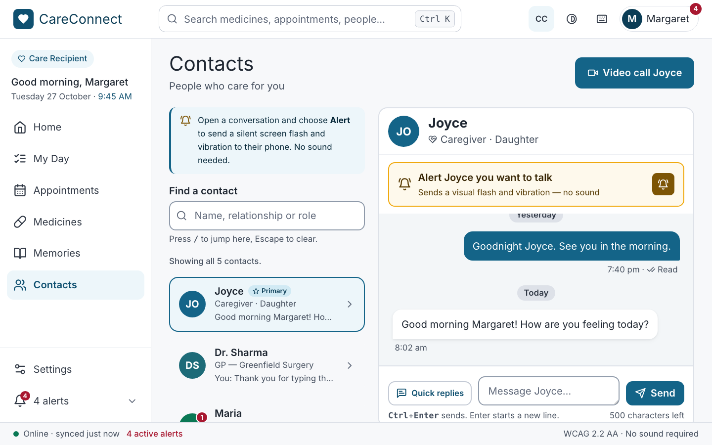
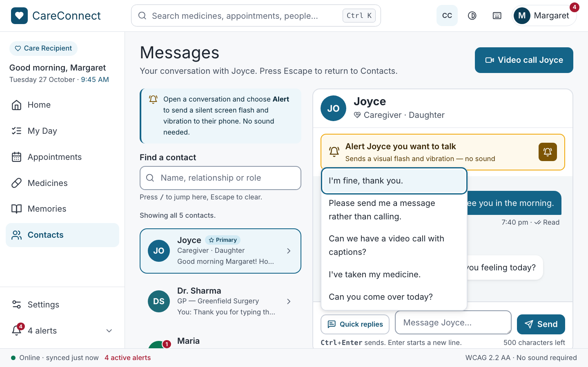
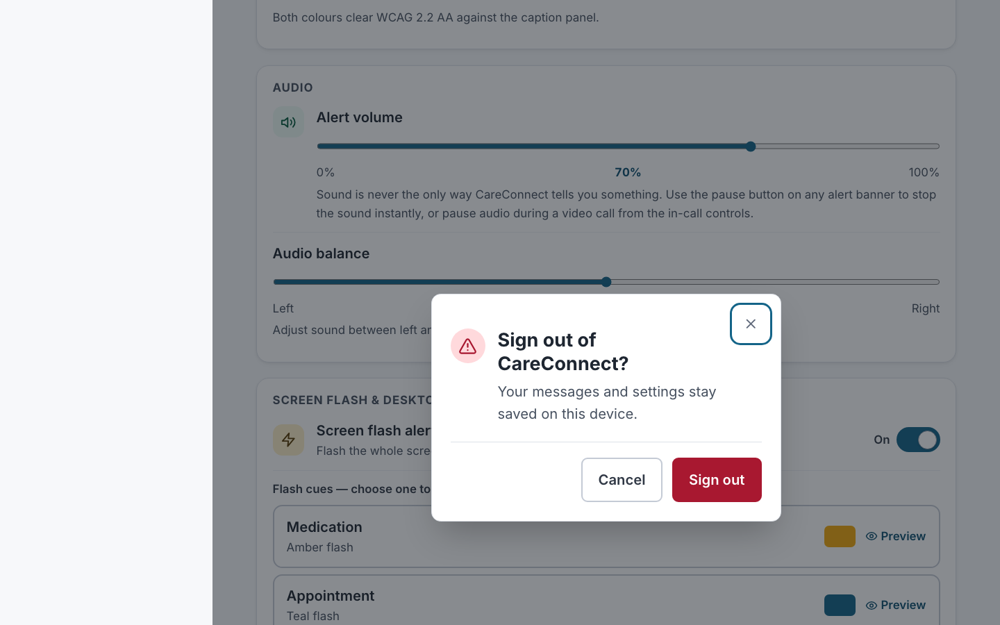

# Assignment 11: Contacts, Messaging and Accessibility Settings (Victor Lee)

**SWEN 661 Team 2 (The Acuity Health Group).** This is Victor's part of the
team's Assignment 11 Word document. It covers the **Contacts**,
**Messaging** (conversation) and **Accessibility Settings** screens of the
React web app, and the **app shell** (header, sidebar, phone and tablet menu,
status bar) that every screen sits in, which Victor rebuilt to the Figma web
design after the team's three branches were merged. The headings follow the
submission's sections, so each part can be pasted into the matching section
of the team document. Every screenshot is in [`screenshots/`](screenshots);
the team overview is in [`../README.md`](../README.md).

| Item | Where |
|:--|:--|
| Source | [`src/pages/Contacts.tsx`](../../../../src/pages/Contacts.tsx), [`src/pages/MessageThread.tsx`](../../../../src/pages/MessageThread.tsx), [`src/pages/AccessibilitySettings.tsx`](../../../../src/pages/AccessibilitySettings.tsx), and the components in [`src/components/contacts/`](../../../../src/components/contacts), [`messaging/`](../../../../src/components/messaging) and [`settings/`](../../../../src/components/settings) |
| App shell | [`src/components/Layout.tsx`](../../../../src/components/Layout.tsx) and [`src/components/navigation/`](../../../../src/components/navigation) (sidebar, drawer, search, account menu, shortcuts dialog, status bar, alerts), [`AppointmentBanner.tsx`](../../../../src/components/AppointmentBanner.tsx), [`CaptionStrip.tsx`](../../../../src/components/CaptionStrip.tsx) |
| State | [`src/context/MessagesContext.tsx`](../../../../src/context/MessagesContext.tsx), [`src/context/SettingsContext.tsx`](../../../../src/context/SettingsContext.tsx) (Context API) |
| Custom hooks | [`useLocalStorageState`](../../../../src/hooks/useLocalStorageState.ts), [`useOnlineStatus`](../../../../src/hooks/useOnlineStatus.ts), [`useMediaQuery`](../../../../src/hooks/useMediaQuery.ts), [`useFocusTrap`](../../../../src/hooks/useFocusTrap.ts), [`useHighContrast`](../../../../src/hooks/useHighContrast.ts) |
| Design reference | Figma file *Webpage design*: every screen at 1440 and 402 px, and Contacts, Messaging and Accessibility Settings at 768 px |
| Domain logic | [`src/models/`](../../../../src/models), [`src/utils/`](../../../../src/utils) |
| Unit and component tests | 195 Jest tests in 19 suites of my own, plus my routes and the app-shell tests in the team's accessibility suite (listed in [§3](#3-testing-implementation)) |
| E2E tests | [`e2e/`](../../../../e2e) (Playwright), 13 tests covering 5 critical flows, run in 4 browser projects |
| Coverage | [`coverage/lcov-report/index.html`](../../../../coverage/lcov-report/index.html) |

---

## 1. Completed responsive application

### What was built

The web app had a Contacts page that was a list of `tel:` "Call" buttons, and
it had no Messaging or Accessibility Settings screens. Those screens existed
only in the desktop (Electron) and mobile clients. This week I ported all
three to React so the web version has the same features. I also rebuilt
Contacts around CareConnect's main rule: *anything the app communicates
through sound must also be communicated visually or in text*.

| Screen | Route | What it does |
|:--|:--|:--|
| Contacts | `/app/contacts` | Lists everyone, with the primary contact first. Each row is a **link to a written conversation**, never a voice call. A row shows a coloured avatar, a preview of the last message and a red count of messages waiting (also written out for screen readers). Search matches name, relationship or role (for example, "doctor" finds Dr. Sharma). The header's one action is **Video call Joyce**, a captioned video call. **On a desktop the primary contact's conversation opens beside the list**, as in the Figma design. |
| Conversation | `/app/contacts/:contactId` | Shows the message history grouped under "Today" and "Yesterday" pills. A **voicemail is shown as its transcript**. A **video message is drawn with its caption track over the video**, in the size and colour chosen in Settings, and Play steps through the captions line by line, with the full words printed below. Delivery state is written as a word ("Delivered"), not shown as a tick alone. The **Alert** button sends a silent visual flash and vibration instead of a ring, and leaves an **"Alert sent to Joyce"** banner behind after the flash fades. Other features: a captioned video-call request, a **Quick replies** menu, a message form with validation, and offline queueing. On a desktop the contact list stays on the left. |
| Accessibility Settings | `/app/settings` | Six cards, as in the design: **Visual Alerts** (banners shown as "Always on" with a padlock, smart escalation), **Captions** (on/off, size and colour as equal-width choices, live preview), **Audio** (volume and left/right balance sliders with the value printed under the track), **Screen Flash & Desktop Alerts** (screen flash on/off, a preview of each alert type's flash colour, desktop notifications through the browser's Notification API, connected devices), **Vibration** (on/off and the three alert rhythms, played as a visual pulse and as a real vibration on phones that support it), and **Account** with Sign out behind a confirmation dialog. |

**Requirements met in this part:**

| Requirement | How |
|:--|:--|
| React Router | New routes `contacts/:contactId` and `settings` under `/app/*`. The **Contacts, Conversation and Settings pages are loaded with `React.lazy`**, so each builds as its own chunk (`Contacts-*.js` 5.5 kB, `MessageThread-*.js` 12.6 kB, `AccessibilitySettings-*.js` 12.3 kB) and loads on first visit, not with the home screen. |
| State management | Context API. `MessagesProvider` holds contacts, conversations, read state and the offline queue. `SettingsProvider` holds the accessibility preferences. Each context object and its `use…` hook live in a separate module ([`messages.ts`](../../../../src/context/messages.ts), [`settings.ts`](../../../../src/context/settings.ts)), so React Fast Refresh keeps working and ESLint passes with no new warnings. |
| Custom hooks | `useLocalStorageState(key, initial, revive)` is `useState` that is saved to localStorage. It checks and repairs whatever is stored (bad JSON or the wrong types fall back to safe values), and it keeps working when storage is blocked. `useOnlineStatus()` uses `useSyncExternalStore` on the browser's `online` and `offline` events. `useMediaQuery(query)` does the same for a CSS media query, so the desktop two-pane layout is *mounted* only on wide screens (opening a conversation marks it read, which must not happen behind a phone's list). |
| Reusable components | `ContactList`, `ContactRow`, `ContactAvatar`, `ContactsPageHeader`, `ContactsTwoPane`, `Conversation` (used by both pages), `MessageBubble`, `CaptionedVideo`, `MessageComposer`, `QuickReplies`, `NotifyButton`, `VideoCallButton`, `VisualFlash` (now with a colour per alert type), `SettingsSection`, `SettingsSwitchRow`, `SettingsSliderRow`, `SegmentedChoice`, `FlashCueRow`, `SettingIcon` and `VibrationPatternRow`, plus the team's existing `Banner`, `Button` and `ConfirmDialog`. |
| Form handling and validation | The message form is a real `<form>` with a labelled `<textarea>`. Ctrl/⌘+Enter or the Send button submits it. An empty message, or one over 500 characters, is refused with a written reason (`role="alert"`, linked to the field with `aria-describedby`, and the field gets `aria-invalid`). Focus returns to the field. A live counter shows the characters left. |
| Offline functionality | Conversations and settings are kept in localStorage, so nothing is fetched and both screens work with no connection. A message written offline is **kept, marked "Sending" in words, and sent automatically when the connection returns**. A banner explains this while offline. The team's service worker serves the app shell and the cached lazy chunks, so the screens also open from cold while offline. This is verified by an E2E test. |
| PWA | Uses the team's manifest and service worker. My screens add the offline behaviour above. |

### The app shell, aligned to the Figma design

After Justin's and Upneet's branches were merged into this one, the whole
app was compared with the Figma board at 402, 768 and 1440 px. My three
screens already matched, but the frame around every screen did not: the app
had a large date-and-time header with a "Message my caregiver" button and,
on phones, a bottom tab bar whose labels were cut off ("Appoi…", "Medici…").
I rebuilt the shell to the design:

| Part | What it is | Where |
|:--|:--|:--|
| Header | Logo; **search** ("Search medicines, appointments, people…", Ctrl/⌘ K); **CC** (captions on/off, the same setting as Settings); **high contrast**; **keyboard shortcuts**; the **avatar** with the alerts badge, which opens the account menu (Switch role, Sign out) | `Layout.tsx`, `navigation/AppSearch.tsx`, `AccountMenu.tsx`, `ShortcutsDialog.tsx` |
| Sidebar (1024 px and up) | Role pill, "Good morning, Margaret" with the date and time, the six pages, then **Settings** and **"5 alerts"** pinned to the foot. The alerts button expands into a list of links (unread messages, medicines still to take, today's visits) | `navigation/SideNav.tsx`, `NavPanel.tsx`, `useAlerts.ts` |
| Menu drawer (below 1024 px) | The same panel slides in from the left when ☰ Menu is pressed, as the design's phone and tablet frames show. It also holds the search field and the high-contrast switch, which the header has no room for there | `navigation/NavDrawer.tsx` |
| Status bar | "Online · synced just now", the number of active alerts in red, and "WCAG 2.2 AA · No sound required". Sticky along the foot | `navigation/StatusBar.tsx` |
| Visual alert and captions | The **Upcoming appointment** banner (Pause, OK) on Home, My Day, Appointments and Medicines, and the dark **[CC]** caption strip under it. Both read Accessibility Settings, so turning captions off, or changing their size or colour, changes them everywhere | `AppointmentBanner.tsx`, `CaptionStrip.tsx` |

The same pass reworked the teammates' screens that differed from the board
(Medicines and Appointments into a list with a detail panel, Memories into a
single list) and applied the caption settings to the simulated video call on
Home; those changes are described in the team overview and in Upneet's
write-up. `SHOW_TEAMMATE_PAGES` in [`src/branchScope.ts`](../../../../src/branchScope.ts)
is now `true`, so every route shows its real page. The "build in progress"
page ([`PlaceholderPage.tsx`](../../../../src/pages/PlaceholderPage.tsx)) is
kept for any future screen without an owner.



### Matching the Figma design

The three screens follow the team's Figma web design (*Webpage design*):

- **Contacts and Messaging** use the design's two-pane desktop layout: the
  hint, search box and contact rows on the left, the open conversation on the
  right with the amber **Alert** bar, grey message area, white incoming and
  teal outgoing bubbles, a "Today" pill and a composer bar (quick replies,
  message field, Send). Phones and tablets show the list and the conversation
  as separate screens, as the design's 402 px and 768 px frames do.
- **Accessibility Settings** uses the design's white cards with small
  capitalised headings, a coloured icon tile beside each setting, equal-width
  caption choices, sliders with the value under the middle of the track, the
  **Screen Flash & Desktop Alerts** card and the **Vibration** card with Play
  buttons.
- **Hard-of-hearing changes made in the design and the code together:** every
  "Call *name* now" voice button became **Video call *name*** (captioned,
  never rings); the Alert copy says exactly what the other person gets (a
  silent flash and vibration); video messages show their captions on the
  video; and faint grey text was darkened to meet 4.5:1.
- **The app shell now follows the design too** (see above): header, sidebar,
  phone and tablet menu drawer, and status bar.

### Matching the desktop and mobile apps

The three web screens follow the versions the team built in earlier weeks:
the Electron desktop app (Weeks 8–9) and the React Native and Flutter phone
apps. All three of those already agree with each other, so they are the
reference.

| Same as desktop and mobile | Detail |
|:--|:--|
| Data and rules | The contact, message and accessibility-settings models are the desktop and mobile files, copied unchanged with their unit tests. The contacts and conversations are the same Week 3 prototype data (Joyce as primary, Dr. Sharma, Maria, James, NHS 111). |
| Contacts | One list, primary first. Each card shows initials, name, a Primary badge, the relationship, a preview of the last message, and a waiting count. The hint about getting someone's attention with Alert. No voice-call button. |
| Conversation | The header shows the name and relationship with its role icon. Captioned video call ("Video call Joyce", which asks for live captions and never rings). "Captions are turned off" warning with **Open settings**. Day headings. Transcripts and caption labels. The Alert button with the same two lines of text. A worded flash, and a short confirmation buzz on the sender's own phone (mobile's `notifyBuzz`, using the browser's Vibration API where it exists). |
| Settings | The same sections in the same order, with the same wording: Visual Alerts (banners locked on), Captions (size, colour and preview), Audio (volume and balance), Screen Flash & Desktop Alerts (from the desktop app), Vibration (switch and three rhythms), and **Account** ("Margaret Whitfield · Care Recipient" with Sign out). |

| Different on the web, on purpose | Why |
|:--|:--|
| Contacts are links, not buttons | On a website, something that goes to another page is a link. Browsers then offer open-in-new-tab and history for free. |
| Search box, opened with "/" | Desktop has search opened with Ctrl+F. Browsers already use Ctrl+F for find in page, and "/" is the usual web shortcut for a page's search. |
| Sign out asks for confirmation first | On desktop it runs straight away. On mobile it isn't built yet ("Sign out is not ready yet"). On the web it really signs out, so it asks first. |
| Offline queue | A website can lose its connection mid-conversation. Messages are kept as "Sending" and go out when the connection returns. |
| No Ctrl/⌘+Shift+N alert shortcut | A desktop-only feature with no browser equivalent the user would expect. Desktop notifications *are* offered, through the browser's own permission prompt. |

**No voice calls anywhere.** The original web header had a green **Call my
caregiver** button that dialled Joyce's phone number (`tel:`). None of the
other apps has a voice-call button, because a phone call is the one channel
a deaf user can't rely on. It first became **Message my caregiver**; with the
Figma header it is gone, and Joyce is reached from Contacts, from search, or
from Home's video preview, which opens Maria's written conversation. The team
accessibility suite checks that no `tel:` link exists.

### Screenshots at 375 / 768 / 1440 px

| | Mobile 375 px | Tablet 768 px | Desktop 1440 px |
|:--|:--|:--|:--|
| Contacts | [top](screenshots/mobile/01-contacts-top.png) · [bottom](screenshots/mobile/01-contacts-bottom.png) | [full page](screenshots/tablet/01-contacts.png) | [full page](screenshots/desktop/01-contacts.png) |
| Conversation | [top](screenshots/mobile/02-conversation-top.png) · [bottom](screenshots/mobile/02-conversation-bottom.png) | [full page](screenshots/tablet/02-conversation.png) | [full page](screenshots/desktop/02-conversation.png) |
| Accessibility Settings | [top](screenshots/mobile/03-settings-top.png) · [bottom](screenshots/mobile/03-settings-bottom.png) | [full page](screenshots/tablet/03-settings.png) | [full page](screenshots/desktop/03-settings.png) |
| Navigation | [mobile](screenshots/mobile/04-navigation.png) | [tablet](screenshots/tablet/04-navigation.png) | [desktop](screenshots/desktop/04-navigation.png) |


App shell: [search with Ctrl K](screenshots/features/shell-search.png),
[account menu](screenshots/features/shell-account-menu.png),
[alerts list](screenshots/features/shell-alerts-list.png),
[keyboard shortcuts](screenshots/features/shell-shortcuts-dialog.png),
[high contrast](screenshots/features/shell-high-contrast.png),
[captions off from the header](screenshots/features/shell-captions-off-home.png),
[menu drawer opened by Ctrl K on a phone](screenshots/features/shell-drawer-search-mobile.png).

Feature states: [search](screenshots/features/contacts-search.png),
[no match](screenshots/features/contacts-no-match.png),
[voicemail transcript](screenshots/features/voicemail-transcript.png),
[form validation](screenshots/features/composer-validation.png),
[alert flash](screenshots/features/alert-flash.png) →
[alert sent banner](screenshots/features/alert-sent-banner.png),
[video call requested](screenshots/features/video-call-requested.png),
[captioned video playing](screenshots/features/captioned-video-playing.png),
[flash cue preview](screenshots/features/settings-flash-preview.png),
[offline: queued](screenshots/features/offline-queued.png) →
[back online: sent](screenshots/features/offline-sent.png),
[captions off](screenshots/features/settings-captions-off.png) →
[warning in a conversation with a video](screenshots/features/conversation-captions-warning.png).

### How the layout adapts

- **Contacts.** One column of rows on phones and tablets, as in the design.
  From 1024 px the list narrows to a 19–22 rem column and the primary
  contact's conversation opens beside it. The preview line is cut off with an
  ellipsis, and the waiting count sits on the avatar's corner, so the name and
  relationship keep their room at 375 px. The **Video call** button is full
  width under the title on phones and beside it from 768 px.
- **Conversation.** Phones and tablets: a full-width card under **Back to
  contacts**. Desktop: the same card in the right-hand pane, as tall as the
  window allows, so the history scrolls inside it and the message field stays
  in view. Bubbles take up to 85% of the width on mobile and 70% from 768 px.
  The Quick replies and Send buttons show their words from 768 px and are
  labelled icons below that.
- **Settings.** A single readable column of cards at every width, capped at
  56 rem on desktop. The size and colour choices share the row equally, and
  each rhythm's pattern sits under its name.
- **Navigation.** From 1024 px the sidebar sits beside the page, with
  Settings at its foot. Below 1024 px (phones and tablets, as in the design's
  402 and 768 px frames) the header keeps only ☰ Menu, the logo, CC and the
  avatar, and Menu opens the same panel as a drawer. The sidebar and drawer
  render one component (`NavPanel`) from one list (`navItems.ts`), so they
  cannot drift apart.
- **Touch and click targets.** Every control is at least 44 × 44 px. Contact
  rows are 72 px or taller, and the Alert button is at least 56 px. The switch
  hit area covers the whole visible track, not just the hidden checkbox.
- No horizontal scrolling at 320, 375, 768 or 1440 px, and **no axe-core
  violations** on Contacts, a conversation (including with the Alert banner
  and the Quick replies menu open) and Settings at all four widths. Checked
  with `@axe-core/playwright` and an E2E test; there are no console errors or
  warnings.

**Shared-layout fixes found by my tests.** The old header (date, time,
greeting and "Call my caregiver") was about 360 px tall at 375 px; pinned in
place it covered the conversation's Send button, failing WCAG 2.4.11 (Focus
Not Obscured), which the mobile Safari E2E run caught. The Figma header is
68 px at every width, so it is sticky again everywhere. Its height and the
status bar's are measured into `--header-height` and `--status-height`;
`scroll-padding` keeps focused fields clear of both, and the desktop sidebar
stops above the status bar instead of running under it.

---

## 2. Accessibility implementation

### Semantic HTML, names and ARIA

Native elements are used wherever they already provide the behaviour. ARIA is
added only where HTML has no element for the job.

| Element | Markup | Why |
|:--|:--|:--|
| Contact row | `<a href>` (React Router `<Link>`) inside `<ul aria-label="Your contacts">` | It goes somewhere, so it is a link. Its name is the printed text in printed order ("Joyce Primary Caregiver · Daughter …"), which satisfies WCAG 2.5.3. The red count on the avatar is decorative; "1 message waiting" and "Urgent care service" are added in `sr-only` text. On a desktop the open contact's row has `aria-current="true"`. |
| Search | `<label>` + `<input type="search">`, hint linked with `aria-describedby` | Exposed as a named searchbox. |
| Search result count | `<p role="status">` | Reads out "2 contacts match 'daughter'", because rows disappearing is invisible to a screen-reader user. |
| Conversation history | `<div role="region" aria-label="Conversation with Maria" tabindex="0">` containing a `<ul>`, with day headings as `<h2>` | Keyboard users can scroll it (WCAG 2.1.1), and screen-reader users can jump by heading. |
| Message bubble | Plain text: author, "Transcript · Voicemail · 0:34", body, time, "Delivered" | Nothing is folded into an `aria-label`. Icons are `aria-hidden` and each sits next to the word it stands for. |
| Alert button | `<button>` whose name is its two printed lines | No `aria-label`, so what is announced matches what is shown. |
| Alert flash | Shown inside a `role="status"` region that is always present, then an "Alert sent to Joyce" banner (`role="status"`, dismissable) | The words are announced. A flash with no words would only tell a deaf user that *something* happened, and the banner stays in case the flash was missed. |
| Video call | `<button>` "Video call Joyce" with `aria-label="Video call Joyce with live captions"` | The accessible name starts with the printed words (WCAG 2.5.3) and adds what the icon cannot say. |
| Captioned video | Play/Pause `<button>` named "Play video message from Maria"; the caption track over the video is `aria-hidden` | The same words are printed in full below the video, so a screen reader reads them once, not twice. |
| Quick replies | Menu button (`aria-haspopup="menu"`, `aria-expanded`, `aria-controls`) opening `role="menu"` with `role="menuitem"` buttons | The ARIA menu pattern, because HTML has no native menu button. |
| Message form | `<form aria-label>`, `<label for>` (visually hidden; the placeholder shows the same words), `<textarea>`, `<button type="submit">` named "Send". On error: `aria-invalid` and `aria-describedby` pointing to the `role="alert"` message | Standard form semantics. The error is announced and tied to its field. |
| Character counter | `role="status"` (polite) | A polite region waits for a pause, so it does not interrupt the user's typing. |
| Settings groups | `<section aria-labelledby>` + `<h2>` | Each group is both a heading and a landmark. |
| On/off settings | `<input type="checkbox" role="switch">` with `<label for>` and a description linked by `aria-describedby`. The locked banner switch is natively `disabled`, drawn as an "Always on" pill with a padlock, and its description says why. The word "On" or "Off" is printed next to the others. | A real checkbox brings Space-to-toggle and the platform's "switch, on" announcement. The printed word means the state is not shown by colour or position alone. |
| Caption size and colour | `<fieldset>` + `<legend>` + native `<input type="radio">` | One Tab stop, arrow keys to change, and "2 of 3" announced, all from the browser. |
| Volume and balance | `<input type="range">` + `<label for>` + `aria-valuetext` ("70 per cent", "50% left") | Arrow, Home, End and Page keys come from the browser. The value is read as words, not "0.7". |
| Vibration rhythms | `<button>` with the description in `aria-describedby`. The lamp is `aria-hidden`. `role="status"` says "Playing the Double pulse rhythm." once | Avoids announcing nine blinks in two seconds. |
| Flash cues | `<button>` per alert type, named by its printed alert type and colour ("Medication Amber flash"); the swatch is `aria-hidden`; the preview flash is a `role="status"` region with the alert's name in words | The colour is never the only signal. |
| Desktop notifications | A switch that asks the browser for permission; if refused, its description changes to a written reason | The user is told why it stayed off, instead of a switch that silently flips back. |
| Sign out | The team's `ConfirmDialog` (`role="dialog"`, `aria-modal`, `aria-labelledby`) | Focus moves into the dialog and returns to the trigger when it closes. |
| Header search | `<input type="search" role="combobox">` with `aria-expanded`, `aria-controls`, `aria-activedescendant` and a `role="listbox"` of `role="option"`s; the match count in a `role="status"` region; `aria-keyshortcuts="Control+K Meta+K"` | The ARIA 1.2 combobox pattern. Results appearing under a field are invisible to a screen-reader user, so the count is announced. |
| CC and high contrast | `<button aria-pressed>`; CC is named by its printed letters plus hidden "captions" ("CC captions") | Toggle buttons announce "pressed" or "not pressed", and the name starts with the visible text (WCAG 2.5.3). |
| Avatar | A disclosure `<button aria-expanded aria-controls>` whose name is its content: "Margaret, account menu, 5 alerts" (the first name is visible from 1024 px and visually hidden below) | No `aria-label`, so the visible words are always part of the name. The red badge's number is read with the word "alerts". |
| Menu drawer | `role="dialog" aria-modal="true" aria-label="Menu"` containing `<nav aria-label="Main navigation">`; `useFocusTrap` | Focus moves in, Tab wraps, Escape closes and returns focus to ☰ Menu. Opened by Ctrl K, focus starts in its search field. |
| Sidebar alerts | `<button aria-expanded aria-controls>` "5 alerts" revealing a list of links, each written out ("1 new message from Joyce") | Every alert is words and a destination; nothing is carried by the badge colour alone. |
| Shortcuts | The keyboard button opens a `role="dialog"` with a `<dl>` of `<kbd>` keys and what they do | The shortcuts are discoverable without documentation. There is no "?" shortcut: a single-character shortcut that cannot be turned off fails WCAG 2.1.4. |
| Status bar | `<footer role="contentinfo">` with the connection state as words beside the coloured dot | The state never rests on colour. |
| Caption strip | A `<p>` with "[CC]" hidden from screen readers and "Caption:" read first | The caption's text, size and colour come from Settings; with captions off it is not rendered. |

`jest-axe` runs the axe-core rules on all three routes inside the real app
shell, with no violations. The routes are in the team's
`src/accessibility.test.tsx` route table, which also checks one `<main>`, one
`<h1>`, the skip link and a unique page title per route.

### Keyboard operation

| Key | Contacts | Conversation | Settings |
|:--|:--|:--|:--|
| **Tab / Shift+Tab** | Video call → search → each contact row in list order (desktop: then the open conversation) | Back (or the contact list on desktop) → Video call → Alert → any banner's Dismiss → history region → Quick replies → message field → Send | Each switch → caption size group → caption colour group → sliders → flash cue buttons → notification switches → vibration switch → rhythm buttons → Sign out |
| **Enter** | Opens the focused conversation | Activates Back, Video call, Alert, Play, Quick replies, a reply or Send. In the field, Enter starts a new line | Activates flash previews, rhythm buttons and Sign out |
| **Ctrl/⌘ + Enter** | — | Sends the message from the field | — |
| **Space** | — | Activates buttons | Toggles a switch, activates buttons |
| **Arrow keys** | — | Scroll the focused history region (as do Page Up/Down). Down on Quick replies opens the menu; Up/Down, Home and End move through it | Change the caption size or colour, move a slider |
| **Escape** | Clears the search | Closes the Quick replies menu and returns focus to its button. Otherwise returns to Contacts, *except* in the message field, where it would throw away a draft | Closes the Sign out dialog and returns focus to the Sign out button |
| **/** | Jumps to the search box from anywhere on the page, but not while typing in a field | — | — |

The app shell adds, on every screen:

| Key | What it does |
|:--|:--|
| **Ctrl+K / ⌘K** | Focuses the header search on desktop; below 1024 px opens the Menu drawer with its search focused |
| **↑ ↓, Enter, Escape** (in search) | Move through the matches, open one, clear the search (a second Escape reaches the page or drawer) |
| **Escape** | Closes the account menu, the drawer or the shortcuts dialog and returns focus to the button that opened it |

**Focus management.** After any in-app navigation the team's layout moves
focus to `<main>`, so a screen reader announces the new page. The page title
also changes ("Conversation — CareConnect"). After sending, focus stays in the
message field so the next message can be typed straight away. After a refused
send, focus returns to the field next to the error. "Clear search" puts focus
back in the search box. Opening Quick replies moves focus to the first reply;
choosing one puts it in the message field and moves focus there; Tab or a
click elsewhere closes the menu. The Sign out dialog traps focus and returns
it to the button that opened it.

**Visible focus.** The team's 3 px `calm-600` outline is applied to every
focused element. The two custom-styled controls carry it explicitly: the
switch track (`peer-focus-visible:outline`) and the selected radio segment
(`has-[:focus-visible]:outline`, drawn inside the segment so it stays clear of
its neighbours). The alert overlay is `pointer-events: none`, so it can never
take focus or block a click.

**Motion.** The alert flash is one slow fade, never a strobe (WCAG 2.3.1).
Under `prefers-reduced-motion` it is shown as a steady panel for the same
1.6 seconds. Before this fix, the global reduced-motion rule jumped the
animation straight to its invisible last frame, so the words were never
seen.

### Keyboard testing results

The keyboard paths are automated with real key presses in Playwright
(`e2e/settings-keyboard.spec.ts`, Chromium, WebKit and mobile Safari) and in
React Testing Library with `user-event`. Everything in the table above passes.
The screenshots below were captured from real key presses by
`scripts/week11-victor-evidence.mjs`.

> **Victor, before submitting:** do a manual keyboard pass in Chrome and in
> Safari (with Full Keyboard Access on) and add one sentence here confirming
> it.

| | |
|:--|:--|
|  "/" jumps to the search box |  Tab reaches the first contact; Enter opens it |
|  Shift+Tab from the history to the Alert button |  Down arrow on Quick replies opens the menu, focus on the first reply |
|  Escape closes it; Tab reaches the message field | |
|  Ctrl+Enter sent it; focus stays in the field |  Focus ring on a switch |
|  ArrowRight selects "Large"; the preview updates |  Enter on Sign out opens the confirmation dialog |
|  Escape closes it; focus is back on Sign out | |

One browser difference: **Safari on macOS skips form controls on Tab** unless
Full Keyboard Access is turned on in System Settings. This is a platform
setting, not an app defect. The WebKit E2E test therefore focuses the radio
group directly, while Chromium and mobile Safari use Tab.

---

## 3. Testing implementation

### Strategy

These were the biggest risks: losing a hearing-accessibility guarantee (for
example, a voice-only path or a wordless alert), losing data (offline
messages, saved settings) and keyboard dead ends. The tests are split across
three levels:

1. **Unit tests (Jest).** Pure rules with no React. Previews and "waiting"
   counts, transcript and caption headings, setting clamps and the locked
   banner, repairing corrupt saved data, search matching (including ignoring
   accents), message validation, date and time formatting, and vibration
   timing.
2. **Component tests (React Testing Library and `user-event`).** Each screen
   rendered with its real providers and router. Interactions are driven the
   way a user would (typing, clicking, Tab, Space, arrows, Escape, Ctrl+Enter),
   and queries use **roles and accessible names**, so a test that passes also
   shows the screen is labelled correctly. The Context providers and both
   hooks are tested with `renderHook`, including offline/online events and
   storage that refuses writes.
3. **End-to-end tests (Playwright).** Run against the *production build*
   (`vite preview`, with the service worker active) in Chromium, Firefox,
   WebKit (desktop Safari) and mobile Safari at 375 px.

### Unit tests: 112 tests, 10 suites

`src/models/__tests__/{contact,message,accessibilitySettings,vibrationPattern,flashCue}.test.ts`,
`src/utils/__tests__/{search,validators,formatters,captions,notifications}.test.ts`

```ts
// src/models/__tests__/accessibilitySettings.test.ts
it('never honours a request to switch the visual banner off', () => {
  expect(withSettings(defaultSettings, { visualAlertBanners: false }).visualAlertBanners).toBe(true);
});
```

### Component tests: 92 tests, 10 suites

| Suite | Tests | Covers |
|:--|--:|:--|
| `src/pages/Contacts.test.tsx` | 12 | No `tel:` links anywhere, previews and waiting counts, search with the announced result count, Escape clears, "/" focuses, empty state, Enter opens a conversation, the captioned video-call request, and the desktop two-pane layout (primary conversation open, its row `aria-current`, marked read) |
| `src/pages/MessageThread.test.tsx` | 27 | Transcript and caption headings, relationship shown in words, day headings, send with the button and with Ctrl+Enter, Enter adds a new line, empty-message error linked to the field, counter, alert flash, "Alert sent" banner and written record, confirmation buzz (and none when vibration is off), vibration-off wording, captioned call request (and arriving with one from Contacts), captions-off warning, captioned video playback line by line in the chosen colour, Quick replies by keyboard (arrows, Home, End, Enter, Escape, Tab, click outside), offline queue → sent, Escape behaviour, desktop layout, unknown contact |
| `src/pages/AccessibilitySettings.test.tsx` | 19 | Named regions and switches, locked banner switch with its reason and "Always on" pill, Space toggles, captions-off conformance warning, radio group and arrow keys, slider value text, flash cue previews (colour, double flash, words) and disabling them, connected devices, desktop notifications (granted, blocked, unsupported browser), vibration rhythm (fake timers and `navigator.vibrate`), Account section and sign out through the dialog, repair of corrupt saved data |
| `src/pages/PlaceholderPage.test.tsx` | 5 | Screen name, owner (or "not yet assigned"), Go to Contacts, the standalone skip link, banner, main and title, and continuing as the demo care recipient (sign-up the first time, sign-in after) |
| `src/context/*.test.tsx` | 13 | Seeding, read state, blank-message guard, alert record, corrupt storage, offline queue, error outside the provider, clamping |
| `src/hooks/*.test.ts` | 7 | Saving and repairing stored values, storage that refuses writes, online/offline switching, a media query following window resizes |
| `src/accessibility.test.tsx` (team suite) | +9 | axe, landmark and title checks on my three routes. The header test now also checks there is no `tel:` link |

```tsx
// src/pages/MessageThread.test.tsx
it('queues messages written offline and sends them when the connection returns', async () => {
  const user = userEvent.setup();
  renderThread('c1');
  setOnline(false);
  expect(screen.getByText('You are offline')).toBeInTheDocument();

  await user.type(screen.getByRole('textbox', { name: 'Message Joyce' }), 'Written offline');
  await user.click(screen.getByRole('button', { name: 'Send' }));
  expect(screen.getByText('Sending')).toBeInTheDocument();

  setOnline(true);
  expect(screen.queryByText('Sending')).not.toBeInTheDocument();
});
```

The team suite `src/accessibility.test.tsx` (77 tests) also holds the
app-shell tests I wrote with the Figma rebuild: one sidebar per role with
Settings and the alerts at its foot, the alerts list, the Menu drawer as a
modal dialog for both roles (focus in, Escape returns it), choosing a page
closes the drawer, CC switching captions everywhere and saving it, high
contrast theming the document and being remembered, Ctrl+K search finding a
medicine and opening its page (and opening the drawer with search focused on
a phone), the keyboard button opening the shortcuts dialog (and "?" not doing so), the account menu, the status
bar, and axe at phone width on every route.


The first screenshot lists my 19 suites (195 tests). The whole web app runs
**375 Jest tests in 29 suites, all passing**. (Before the merge this branch
ran 516; the difference is the older Appointments, Medicines and Memories
page tests, which Upneet replaced with his own smaller suites.)

**A clock bug found while recreating these screenshots.** Run just after
midnight, two `MessagesContext` tests failed: the seed puts this morning's
messages at 8:02 and 9:05, which at 00:40 are still in the future, so a
message sent "now" sorted *above* them. `buildSeedMessages` now moves the
whole seed back when its newest message would be in the future (order and
gaps unchanged), and the day-heading test pins its clock to midday.

### End-to-end tests (Playwright): 5 critical flows

[`e2e/contacts-messaging.spec.ts`](../../../../e2e/contacts-messaging.spec.ts),
[`e2e/settings-keyboard.spec.ts`](../../../../e2e/settings-keyboard.spec.ts),
config in [`playwright.config.ts`](../../../../playwright.config.ts).

1. **Find → open → send → reload.** Search "son", open James, send a
   message, reload, and see it saved and shown as the preview on Contacts.
2. **Silent alert and captioned calls.** The worded flash appears, the
   "Alert sent" banner stays, and the written record lands in the
   conversation. The Contacts header asks for a captioned video call (no
   `tel:` link anywhere). A video message shows its captions and plays. A
   voicemail shows as a transcript, and an empty send is refused with a
   reason. Quick replies work from the keyboard, and Escape closes the menu
   without leaving the page.
3. **Offline.** `context.setOffline(true)` → the message shows "Sending" →
   back online → it is sent. With the service worker active, Contacts and a
   conversation also **open from cold while offline** (Chromium).
4. **Settings by keyboard only.** Space on a switch, Tab into the radio group,
   arrows, arrow keys on a slider, then a reload confirms everything was
   saved. The Sign out dialog closes with Escape and returns focus, and
   confirming it really signs out. Each flash cue previews its own colour and
   is disabled when screen flashes are off.
5. **Settings across screens and widths.** Captions turned off → a warning
   in a conversation with a video message, which links back to Settings.
   Settings is reachable at every width, with no horizontal scroll.

```ts
// e2e/contacts-messaging.spec.ts
test('messages written offline are queued and sent when the connection returns', async ({ page, context }) => {
  await signInAsPatient(page, '/app/contacts/c3');
  await context.setOffline(true);
  await page.getByRole('textbox', { name: 'Message Maria' }).fill('Sent from the garden');
  await page.getByTestId('composer-send').click();
  const list = page.getByRole('list', { name: 'Messages with Maria' });
  await expect(list.getByText('Sending')).toBeVisible();
  await context.setOffline(false);
  await expect(list.getByText('Sending')).toBeHidden();
});
```

**My specs: 37 passed, 2 skipped by design, 0 failed** (13 tests in each of
Chromium, WebKit and mobile Safari). The two skips are the service-worker
offline test on WebKit, where Playwright cannot emulate it reliably. The
specs work at both widths: at 1440 px the conversation's name is an `<h2>`
beside the list, at 375 px it is the page's `<h1>`. "Settings is reachable at
every width" now opens Settings from the sidebar on desktop and from the Menu
drawer on mobile Safari. The captions test now waits until the switch is off
and saved before leaving the page; under parallel load WebKit could reload
before the setting was written.

**The whole run** (all four spec files, three browser projects): **58
passed, 7 skipped, 1 failed**. The failure is in Upneet's Memories spec, in
Chromium only: after a refused save, the test measures whether the focused
field sits below the sticky header. It fails the same way on the commit
before the Figma work and passed in one of the runs made for these
screenshots, so it is timing-sensitive rather than caused by the shell; it is
listed under the known issues in the team overview.


**Firefox.** The `firefox` project is configured, but Playwright's Firefox
build (v1522) hangs at launch on this development Mac (macOS 27.0.1). It
fails with `sandbox_extension_issue_file_to_process … Operation not permitted`
before any page loads, even with the sandbox turned off, so this is a local
platform problem and not an app or test failure. To still get Firefox
coverage, [`.github/workflows/web-tests.yml`](../../../../.github/workflows/web-tests.yml)
runs lint, typecheck, Jest with coverage and **all four Playwright projects,
including Firefox, on Ubuntu** for every push to `main` and every pull
request. It uploads the coverage and Playwright reports as artifacts.

### Finding the evidence in the repository

| What | Where |
|:--|:--|
| Test files | `src/**/*.test.ts(x)`, `src/models/__tests__`, `src/utils/__tests__`, `e2e/` |
| Shared render helper | `src/test-utils/renderWithProviders.tsx` |
| Screenshot scripts | `scripts/week11-victor-evidence.mjs` (screens, shell, keyboard) and `scripts/week11-testing-evidence.mjs` (these test screenshots, from real runs) |

---

## 4. Coverage report

`npm run test:coverage` writes `coverage/lcov-report/index.html`, which is
committed so it can be read from the repository. Coverage is measured on the
files listed in `collectCoverageFrom` in `jest.config.cjs`, and a
`coverageThreshold` of **75%** on statements, branches, functions and lines
makes the run fail if any of them drops below that.


| Measured scope | Statements | Branches | Functions | Lines |
|:--|--:|--:|--:|--:|
| **All measured files** (Victor's, Upneet's and the app shell) | **95.82%** | **91.14%** | **94.1%** | **96.44%** |
| Contacts.tsx | 100% | 87.5% | 100% | 100% |
| MessageThread.tsx | 100% | 92.3% | 100% | 100% |
| PlaceholderPage.tsx | 95.7% | 92.3% | 100% | 100% |
| AccessibilitySettings.tsx | 98.1% | 100% | 94.7% | 98.0% |
| components/contacts | 100% | 92.3% | 100% | 100% |
| components/messaging | 98.0% | 92.9% | 93.5% | 99.5% |
| components/settings | 100% | 93.9% | 100% | 100% |
| context, utils | 99.5–100% | 100% | 100% | 99.4–100% |
| models | 100% | 99.4% | 100% | 100% |
| Layout.tsx | 89.3% | 79.1% | 83.3% | 90.1% |
| components/navigation (shell) | 83.8% | 73.6% | 78.3% | 84.9% |
| AppointmentBanner.tsx, CaptionStrip.tsx | 82.8%, 100% | 75%, 100% | 50%, 100% | 91.3%, 100% |
| hooks (including useFocusTrap, useHighContrast) | 79.3% | 52.9% | 84.0% | 81.8% |

The app-shell files were added to `collectCoverageFrom` for this report. They
are tested through the real app in the team's accessibility suite and are
above the 75% threshold on lines; the lowest are `StatusBar`'s resize
measurement and `useFocusTrap`'s Tab-wrapping branches, which need real
layout and are exercised by Playwright instead.

**Exclusions and why.**
- `src/**/__tests__/**` and `*.test.*`: test code is not measured.
- `src/data/contactsData.ts` and `messagesData.ts`: static seed data with no
  branches to test.
- `src/test-utils/`: a test helper.
- Apart from the shell measurements above, the only uncovered lines in my files are the `getServerSnapshot` fallbacks
  in `useOnlineStatus` and `useMediaQuery`, which run only during server-side
  rendering (this app renders in the browser only), and
  `useLocalStorageState`'s default `revive` callback, which the providers
  always replace with their own.

---

## 6. Project links and running instructions (for my part)

```bash
npm install
npm run dev                         # http://localhost:5173 — sign in with any email, choose care recipient
npm test                            # Jest + React Testing Library
npm run test:coverage               # + coverage/lcov-report/index.html (fails under 75%)
npx playwright install chromium firefox webkit   # once
npm run test:e2e                    # builds, starts vite preview on :4173, runs every browser
npm run test:e2e -- --project=chromium           # one browser
npm run test:e2e:report             # opens the HTML report
npm run lint && npm run typecheck
node scripts/week11-victor-evidence.mjs     # screenshots (needs npm run dev -- --port 5180)
node scripts/week11-testing-evidence.mjs    # test screenshots from real runs
```

---

## AI usage (my part)

I used Claude (Anthropic) in Claude Code as a pair programmer for this part.
It ported the existing desktop TypeScript models and screens to React with
Tailwind, completed my screens in the team's Figma file and then restyled the
web pages to match those frames, drafted the component and Playwright tests,
and wrote the screenshot scripts and this write-up. I checked the output in
four ways:

- Every test was run and had to pass. The coverage threshold is enforced.
- I compared the screens by eye against the 375, 768 and 1440 px screenshots
  and the Figma frames, and ran axe-core on every state at four widths.
- I ran the keyboard paths with real key presses in Playwright and `user-event`.
- I kept the failures the tests found, which led to real fixes: the
  header covering Send on mobile, and the alert flash being invisible under
  reduced motion.

`npm run lint` reports 0 errors and no new warnings, and
`npm run typecheck` is clean.

---

## Notes for the team

- **Shared files I changed:**
  - `Layout.tsx` and `src/components/navigation/`: the app shell rebuilt to
    the Figma design (header, sidebar, Menu drawer, search, account menu,
    shortcuts dialog, status bar, alerts). `BottomNav.tsx` and
    `MobileMenu.tsx` were removed; Switch role and Sign out moved into the
    avatar's account menu.
  - `AppointmentBanner.tsx`, `CaptionStrip.tsx`, `MockVideoCall.tsx`: the
    visual alert and captions follow Accessibility Settings on every screen.
  - `index.css`: flash and lamp styles, the drawer animation, scroll padding
    for the sticky header and status bar, and the high-contrast overrides.
  - `App.tsx`: my routes, lazy-loaded, and the two providers.
  - `ConfirmDialog.tsx`: more room on the right of the title (`pr-12`).
  - `jest.config.cjs`: `.test.ts` files, `roots: ['src']`, my files and the
    app shell in coverage, and the 75% threshold.
  - `messagesData.ts`: the seed never lands in the future (the clock bug
    above).
- **`SHOW_TEAMMATE_PAGES` is `true`** in `src/branchScope.ts` since the
  merge, so every route shows its real page.
- **New dev dependencies:** `@playwright/test` and
  `@testing-library/user-event`. The new CI workflow runs Firefox, which can't
  launch locally on macOS 27.
