# Assignment 11: Contacts, Messaging and Accessibility Settings (Victor Lee)

**SWEN 661 Team 2 (The Acuity Health Group).** This is Victor's part of the
team's Assignment 11 Word document. It covers the **Contacts**,
**Messaging** (conversation) and **Accessibility Settings** screens of the
React web app. The headings follow the submission's sections, so each part
can be pasted into the matching section of the team document. Every
screenshot is in [`screenshots/`](screenshots).

| Item | Where |
|:--|:--|
| Source | [`src/pages/Contacts.tsx`](../../../../src/pages/Contacts.tsx), [`src/pages/MessageThread.tsx`](../../../../src/pages/MessageThread.tsx), [`src/pages/AccessibilitySettings.tsx`](../../../../src/pages/AccessibilitySettings.tsx), and the components in [`src/components/contacts/`](../../../../src/components/contacts), [`messaging/`](../../../../src/components/messaging) and [`settings/`](../../../../src/components/settings) |
| State | [`src/context/MessagesContext.tsx`](../../../../src/context/MessagesContext.tsx), [`src/context/SettingsContext.tsx`](../../../../src/context/SettingsContext.tsx) (Context API) |
| Custom hooks | [`useLocalStorageState`](../../../../src/hooks/useLocalStorageState.ts), [`useOnlineStatus`](../../../../src/hooks/useOnlineStatus.ts) |
| Domain logic | [`src/models/`](../../../../src/models), [`src/utils/`](../../../../src/utils) |
| Unit and component tests | 159 Jest tests in 14 suites (listed in [§3](#3-testing-implementation)) |
| E2E tests | [`e2e/`](../../../../e2e) (Playwright), 9 tests covering 5 critical flows, run in 4 browser projects |
| Coverage | [`coverage/lcov-report/index.html`](../../../../coverage/lcov-report/index.html) |

---

## 1. Completed responsive application

### What was built

The web app had a Contacts page that was a list of `tel:` "Call" buttons, and
it had no Messaging or Accessibility Settings screens. Those screens existed
only in the desktop (Electron) and mobile clients. This week I ported all
three to React so the web version has the same features. I also rebuilt
Contacts around CareConnect's main rule: *anything the app communicates
through sound must also be communicated visually or in text*.

| Screen | Route | What it does |
|:--|:--|:--|
| Contacts | `/app/contacts` | Lists everyone, with the primary contact first. Each row is a **link to a written conversation**, never a voice call. A row shows a preview of the last message and a "*n* waiting" badge. Search matches name, relationship or role (for example, "doctor" finds Dr. Sharma). |
| Conversation | `/app/contacts/:contactId` | Shows the message history grouped under "Today" and "Yesterday" headings. A **voicemail is shown as its transcript**, a **video message says whether captions are attached**, and delivery state is written as a word ("Delivered"), not shown as a tick alone. The **Alert** button sends a silent visual flash and vibration instead of a ring. Other features: a captioned video-call request, a message form with validation, and offline queueing. |
| Accessibility Settings | `/app/settings` | Visual alert banners (shown but locked on), smart escalation, captions on/off, caption size and colour with a live preview, alert volume and left/right balance sliders, vibration on/off with the three alert rhythms (played as a visual pulse, and as a real vibration on phones that support it), and Reset to defaults behind a confirmation dialog. |

**Requirements met in this part:**

| Requirement | How |
|:--|:--|
| React Router | New routes `contacts/:contactId` and `settings` under `/app/*`. The **Contacts, Conversation and Settings pages are loaded with `React.lazy`**, so each builds as its own chunk (`Contacts-*.js` 5.5 kB, `MessageThread-*.js` 12.6 kB, `AccessibilitySettings-*.js` 12.3 kB) and loads on first visit, not with the home screen. |
| State management | Context API. `MessagesProvider` holds contacts, conversations, read state and the offline queue. `SettingsProvider` holds the accessibility preferences. Each context object and its `use…` hook live in a separate module ([`messages.ts`](../../../../src/context/messages.ts), [`settings.ts`](../../../../src/context/settings.ts)), so React Fast Refresh keeps working and ESLint passes with no new warnings. |
| Custom hooks | `useLocalStorageState(key, initial, revive)` is `useState` that is saved to localStorage. It checks and repairs whatever is stored (bad JSON or the wrong types fall back to safe values), and it keeps working when storage is blocked. `useOnlineStatus()` uses `useSyncExternalStore` on the browser's `online` and `offline` events. |
| Reusable components | `ContactRow`, `MessageBubble`, `MessageComposer`, `NotifyButton`, `VisualFlash`, `SettingsSection`, `SettingsSwitchRow`, `SettingsSliderRow`, `SegmentedChoice` and `VibrationPatternRow`, plus the team's existing `Banner`, `Button` and `ConfirmDialog`. |
| Form handling and validation | The message form is a real `<form>` with a labelled `<textarea>`. Ctrl/⌘+Enter or the Send button submits it. An empty message, or one over 500 characters, is refused with a written reason (`role="alert"`, linked to the field with `aria-describedby`, and the field gets `aria-invalid`). Focus returns to the field. A live counter shows the characters left. |
| Offline functionality | Conversations and settings are kept in localStorage, so nothing is fetched and both screens work with no connection. A message written offline is **kept, marked "Sending" in words, and sent automatically when the connection returns**. A banner explains this while offline. The team's service worker serves the app shell and the cached lazy chunks, so the screens also open from cold while offline. This is verified by an E2E test. |
| PWA | Uses the team's manifest and service worker. My screens add the offline behaviour above. |

### Screenshots at 375 / 768 / 1440 px

| | Mobile 375 px | Tablet 768 px | Desktop 1440 px |
|:--|:--|:--|:--|
| Contacts | [top](screenshots/mobile/01-contacts-top.png) · [bottom](screenshots/mobile/01-contacts-bottom.png) | [full page](screenshots/tablet/01-contacts.png) | [full page](screenshots/desktop/01-contacts.png) |
| Conversation | [top](screenshots/mobile/02-conversation-top.png) · [bottom](screenshots/mobile/02-conversation-bottom.png) | [full page](screenshots/tablet/02-conversation.png) | [full page](screenshots/desktop/02-conversation.png) |
| Accessibility Settings | [top](screenshots/mobile/03-settings-top.png) · [bottom](screenshots/mobile/03-settings-bottom.png) | [full page](screenshots/tablet/03-settings.png) | [full page](screenshots/desktop/03-settings.png) |
| Navigation | [mobile](screenshots/mobile/04-navigation.png) | [tablet](screenshots/tablet/04-navigation.png) | [desktop](screenshots/desktop/04-navigation.png) |

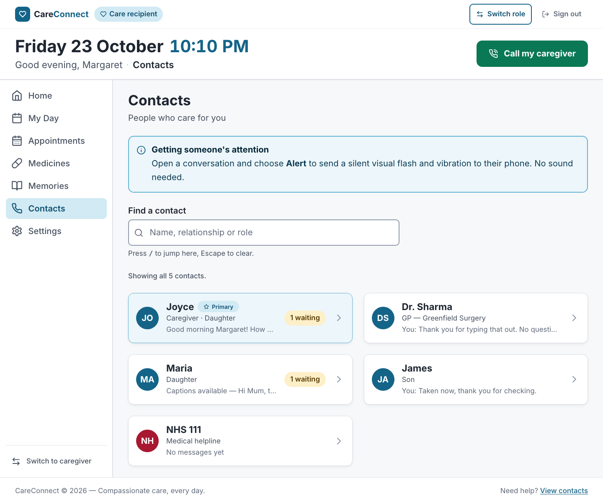
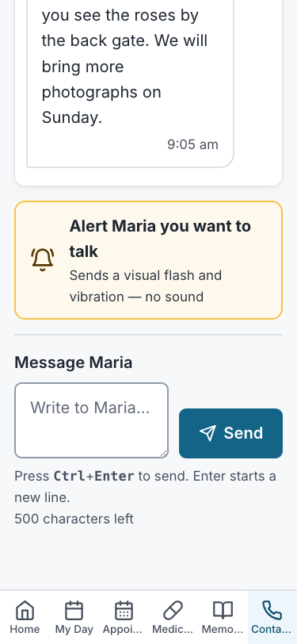
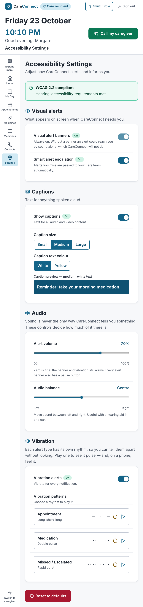

Feature states: [search](screenshots/features/contacts-search.png),
[no match](screenshots/features/contacts-no-match.png),
[voicemail transcript](screenshots/features/voicemail-transcript.png),
[form validation](screenshots/features/composer-validation.png),
[alert flash](screenshots/features/alert-flash.png),
[offline: queued](screenshots/features/offline-queued.png) →
[back online: sent](screenshots/features/offline-sent.png),
[captions off](screenshots/features/settings-captions-off.png) →
[warning in a conversation with a video](screenshots/features/conversation-captions-warning.png).

### How the layout adapts

- **Contacts.** One column on mobile and two from 768 px, using the team's
  `.card-grid`. The preview line is cut off with an ellipsis instead of
  wrapping, so every row stays the same height and is easy to scan.
- **Conversation.** Bubbles take up to 85% of the width on mobile and 70% from
  768 px. The "Call *name*" button sits beside the name on wider screens and
  drops to its own full-width row below 640 px. The page is capped at a
  readable width on desktop.
- **Settings.** A single readable column at every width. The size and colour
  choices wrap rather than overflow at 320 px.
- **Navigation.** Settings appears in the sidebar from 768 px. The care
  recipient's mobile bottom bar holds six tabs at 375 px, so it does not get a
  seventh. Instead, the mobile header shows a labelled **Settings** link, and
  the bottom bar filters on `inBottomBar: false` in `navItems.ts`, the one
  list every navigation surface reads.
- **Touch and click targets.** Every control is at least 44 × 44 px. Contact
  rows are 72 px or taller, and the Alert button is at least 56 px. The switch
  hit area covers the whole visible track, not just the hidden checkbox.
- No horizontal scrolling at 375, 768 or 1440 px. This is checked by an E2E
  test, and there are no console errors or warnings.

**Shared-layout fix found by my tests.** At 375 px the team's sticky header
(date, time, greeting and "Call my caregiver") is about 360 px tall, more than
half the screen. Pinned in place, it covered the conversation's Send button,
which also fails WCAG 2.4.11 (Focus Not Obscured). The mobile Safari E2E run
caught this. The header is now sticky only from 768 px
(`md:sticky md:top-0` in `Layout.tsx`).

---

## 2. Accessibility implementation

### Semantic HTML, names and ARIA

Native elements are used wherever they already provide the behaviour. ARIA is
added only where HTML has no element for the job.

| Element | Markup | Why |
|:--|:--|:--|
| Contact row | `<a href>` (React Router `<Link>`) inside `<ul aria-label="Your contacts">` | It goes somewhere, so it is a link. Its name is the printed text in printed order ("Joyce Primary Caregiver · Daughter …"), which satisfies WCAG 2.5.3. "Urgent care service" is added in `sr-only` text because the screen shows it only through colour. |
| Search | `<label>` + `<input type="search">`, hint linked with `aria-describedby` | Exposed as a named searchbox. |
| Search result count | `<p role="status">` | Reads out "2 contacts match 'daughter'", because rows disappearing is invisible to a screen-reader user. |
| Conversation history | `<div role="region" aria-label="Conversation with Maria" tabindex="0">` containing a `<ul>`, with day headings as `<h2>` | Keyboard users can scroll it (WCAG 2.1.1), and screen-reader users can jump by heading. |
| Message bubble | Plain text: author, "Transcript · Voicemail · 0:34", body, time, "Delivered" | Nothing is folded into an `aria-label`. Icons are `aria-hidden` and each sits next to the word it stands for. |
| Alert button | `<button>` whose name is its two printed lines | No `aria-label`, so what is announced matches what is shown. |
| Alert flash | Shown inside a `role="status"` region that is always present | The words "Alert sent to Joyce…" are announced. A flash with no words would only tell a deaf user that *something* happened. |
| Message form | `<form aria-label>`, `<label for>`, `<textarea>`, `<button type="submit">`. On error: `aria-invalid` and `aria-describedby` pointing to the `role="alert"` message | Standard form semantics. The error is announced and tied to its field. |
| Character counter | `role="status"` (polite) | A polite region waits for a pause, so it does not interrupt the user's typing. |
| Settings groups | `<section aria-labelledby>` + `<h2>` | Each group is both a heading and a landmark. |
| On/off settings | `<input type="checkbox" role="switch">` with `<label for>` and a description linked by `aria-describedby`. The locked banner switch is natively `disabled` and its description says why. The word "On" or "Off" is printed next to it. | A real checkbox brings Space-to-toggle and the platform's "switch, on" announcement. The printed word means the state is not shown by colour or position alone. |
| Caption size and colour | `<fieldset>` + `<legend>` + native `<input type="radio">` | One Tab stop, arrow keys to change, and "2 of 3" announced, all from the browser. |
| Volume and balance | `<input type="range">` + `<label for>` + `aria-valuetext` ("70 per cent", "50% left") | Arrow, Home, End and Page keys come from the browser. The value is read as words, not "0.7". |
| Vibration rhythms | `<button>` with the description in `aria-describedby`. The lamp is `aria-hidden`. `role="status"` says "Playing the Double pulse rhythm." once | Avoids announcing nine blinks in two seconds. |
| Reset | The team's `ConfirmDialog` (`role="dialog"`, `aria-modal`, `aria-labelledby`) | Focus moves into the dialog and returns to the trigger when it closes. |

`jest-axe` runs the axe-core rules on all three routes inside the real app
shell, with no violations. The routes are in the team's
`src/accessibility.test.tsx` route table, which also checks one `<main>`, one
`<h1>`, the skip link and a unique page title per route.

### Keyboard operation

| Key | Contacts | Conversation | Settings |
|:--|:--|:--|:--|
| **Tab / Shift+Tab** | Search → each contact row in list order | Back → Call → history region → Alert → message field → Send | Each switch → caption size group → caption colour group → sliders → vibration switch → rhythm buttons → Reset |
| **Enter** | Opens the focused conversation | Activates Back, Call, Alert or Send. In the field, Enter starts a new line | Activates rhythm buttons and Reset |
| **Ctrl/⌘ + Enter** | — | Sends the message from the field | — |
| **Space** | — | Activates buttons | Toggles a switch, activates buttons |
| **Arrow keys** | — | Scroll the focused history region (as do Page Up/Down) | Change the caption size or colour, move a slider |
| **Escape** | Clears the search | Returns to Contacts, *except* in the message field, where it would throw away a draft | Closes the Reset dialog and returns focus to the Reset button |
| **/** | Jumps to the search box from anywhere on the page, but not while typing in a field | — | — |

**Focus management.** After any in-app navigation the team's layout moves
focus to `<main>`, so a screen reader announces the new page. The page title
also changes ("Conversation — CareConnect"). After sending, focus stays in the
message field so the next message can be typed straight away. After a refused
send, focus returns to the field next to the error. "Clear search" puts focus
back in the search box. The Reset dialog traps focus and returns it to the
button that opened it.

**Visible focus.** The team's 3 px `calm-600` outline is applied to every
focused element. The two custom-styled controls carry it explicitly: the
switch track (`peer-focus-visible:outline`) and the selected radio segment
(`has-[:focus-visible]:outline`, drawn inside the segment so it stays clear of
its neighbours). The alert overlay is `pointer-events: none`, so it can never
take focus or block a click.

**Motion.** The alert flash is one slow fade, never a strobe (WCAG 2.3.1).
Under `prefers-reduced-motion` it is shown as a steady panel for the same
1.6 seconds. Before this fix, the global reduced-motion rule jumped the
animation straight to its invisible last frame, so the words were never
seen.

### Keyboard testing results

The keyboard paths are automated with real key presses in Playwright
(`e2e/settings-keyboard.spec.ts`, Chromium, WebKit and mobile Safari) and in
React Testing Library with `user-event`. Everything in the table above passes.
The screenshots below were captured from real key presses by
`scripts/week11-victor-evidence.mjs`.

> **Victor, before submitting:** do a manual keyboard pass in Chrome and in
> Safari (with Full Keyboard Access on) and add one sentence here confirming
> it.

| | |
|:--|:--|
| 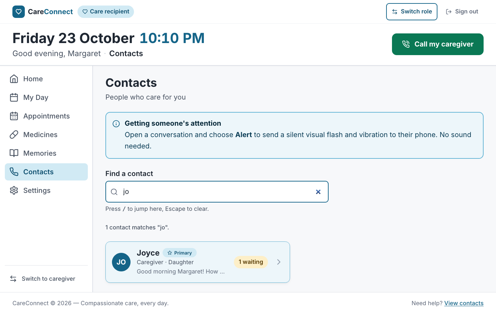 "/" jumps to the search box | 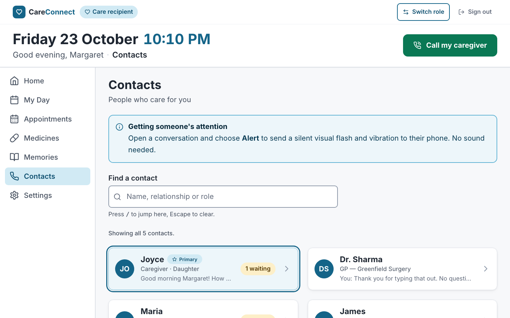 Tab reaches the first contact; Enter opens it |
| 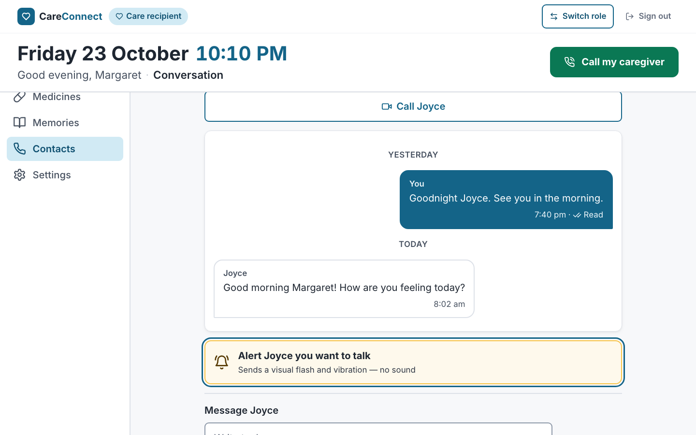 Tab from the history to the Alert button | 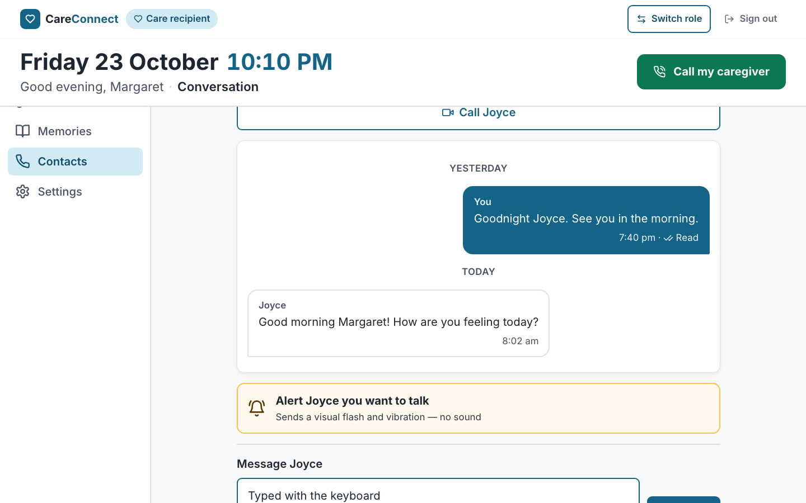 Typing in the message field |
| 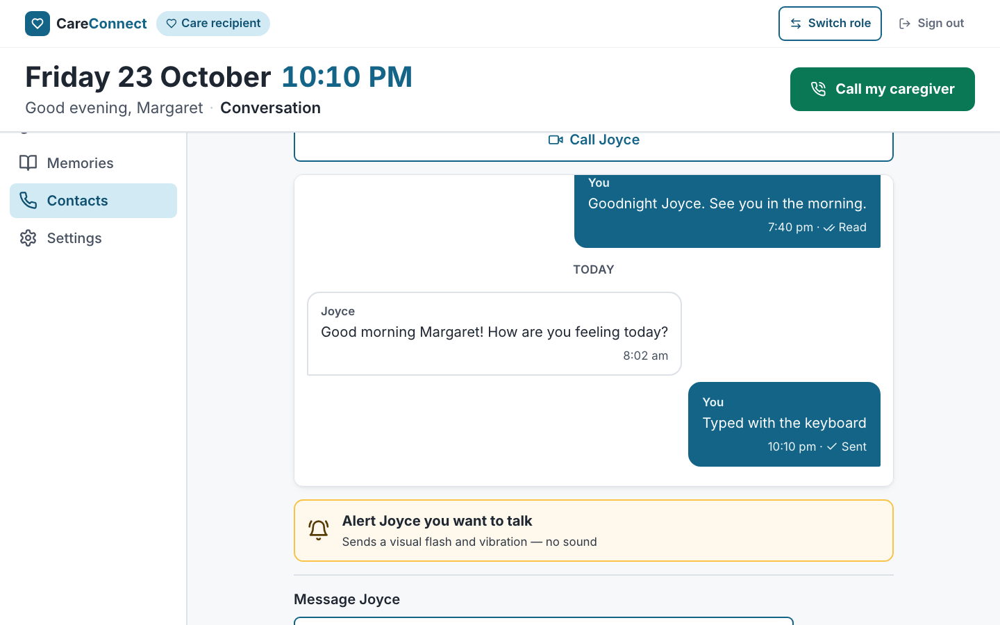 Ctrl+Enter sent it; focus stays in the field | 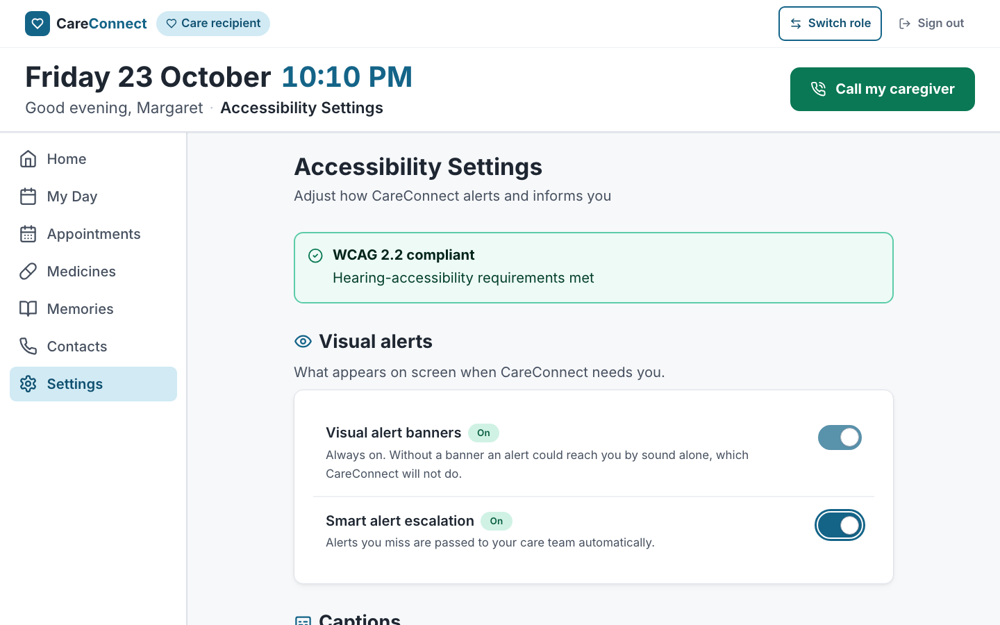 Focus ring on a switch |
| 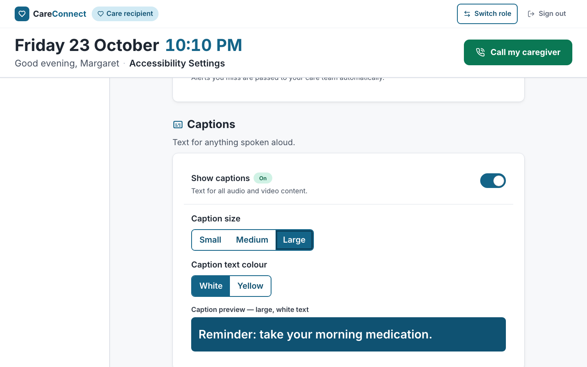 ArrowRight selects "Large"; the preview updates | 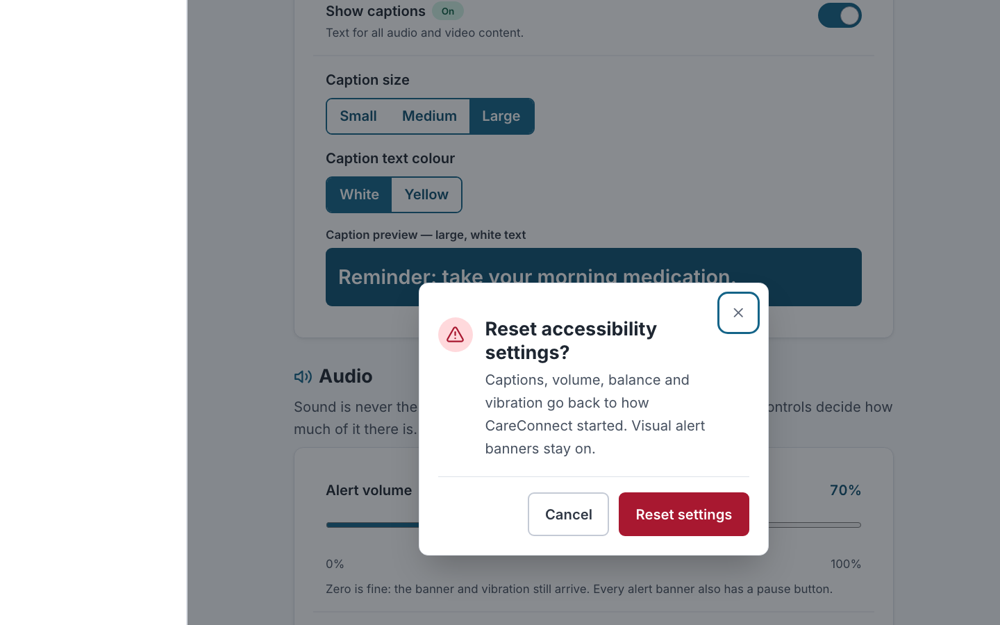 Enter on Reset opens the confirmation dialog |
| 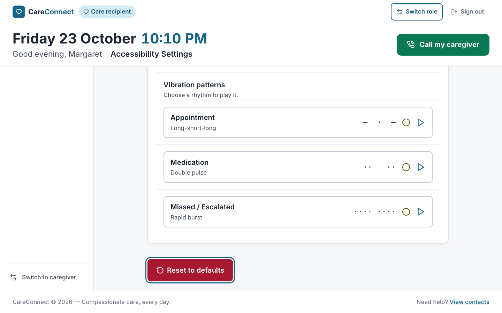 Escape closes it; focus is back on Reset | |

One browser difference: **Safari on macOS skips form controls on Tab** unless
Full Keyboard Access is turned on in System Settings. This is a platform
setting, not an app defect. The WebKit E2E test therefore focuses the radio
group directly, while Chromium and mobile Safari use Tab.

---

## 3. Testing implementation

### Strategy

These were the biggest risks: losing a hearing-accessibility guarantee (for
example, a voice-only path or a wordless alert), losing data (offline
messages, saved settings) and keyboard dead ends. The tests are split across
three levels:

1. **Unit tests (Jest).** Pure rules with no React. Previews and "waiting"
   counts, transcript and caption headings, setting clamps and the locked
   banner, repairing corrupt saved data, search matching (including ignoring
   accents), message validation, date and time formatting, and vibration
   timing.
2. **Component tests (React Testing Library and `user-event`).** Each screen
   rendered with its real providers and router. Interactions are driven the
   way a user would (typing, clicking, Tab, Space, arrows, Escape, Ctrl+Enter),
   and queries use **roles and accessible names**, so a test that passes also
   shows the screen is labelled correctly. The Context providers and both
   hooks are tested with `renderHook`, including offline/online events and
   storage that refuses writes.
3. **End-to-end tests (Playwright).** Run against the *production build*
   (`vite preview`, with the service worker active) in Chromium, Firefox,
   WebKit (desktop Safari) and mobile Safari at 375 px.

### Unit tests: 101 tests, 7 suites

`src/models/__tests__/{contact,message,accessibilitySettings,vibrationPattern}.test.ts`,
`src/utils/__tests__/{search,validators,formatters}.test.ts`

```ts
// src/models/__tests__/accessibilitySettings.test.ts
it('never honours a request to switch the visual banner off', () => {
  expect(withSettings(defaultSettings, { visualAlertBanners: false }).visualAlertBanners).toBe(true);
});
```

### Component tests: 58 tests, 7 suites

| Suite | Tests | Covers |
|:--|--:|:--|
| `src/pages/Contacts.test.tsx` | 9 | No `tel:` links anywhere, previews and waiting badges, search with the announced result count, Escape clears, "/" focuses, empty state, Enter opens a conversation |
| `src/pages/MessageThread.test.tsx` | 18 | Transcript and caption headings, day headings, send with the button and with Ctrl+Enter, Enter adds a new line, empty-message error linked to the field, counter, alert flash and written record, vibration-off wording, captioned call request, captions-off warning, offline queue → sent, Escape behaviour, unknown contact |
| `src/pages/AccessibilitySettings.test.tsx` | 12 | Named regions and switches, locked banner switch with its reason, Space toggles, captions-off conformance warning, radio group and arrow keys, slider value text, vibration rhythm (fake timers and `navigator.vibrate`), reset through the dialog, repair of corrupt saved data |
| `src/context/*.test.tsx` | 14 | Seeding, read state, blank-message guard, alert record, corrupt storage, offline queue, error outside the provider, clamping, reset |
| `src/hooks/*.test.ts` | 5 | Saving and repairing stored values, storage that refuses writes, online/offline switching |
| `src/accessibility.test.tsx` (team suite) | +9 | axe, landmark and title checks on my three routes |

```tsx
// src/pages/MessageThread.test.tsx
it('queues messages written offline and sends them when the connection returns', async () => {
  const user = userEvent.setup();
  renderThread('c1');
  setOnline(false);
  expect(screen.getByText('You are offline')).toBeInTheDocument();

  await user.type(screen.getByRole('textbox', { name: 'Message Joyce' }), 'Written offline');
  await user.click(screen.getByRole('button', { name: 'Send' }));
  expect(screen.getByText('Sending')).toBeInTheDocument();

  setOnline(true);
  expect(screen.queryByText('Sending')).not.toBeInTheDocument();
});
```

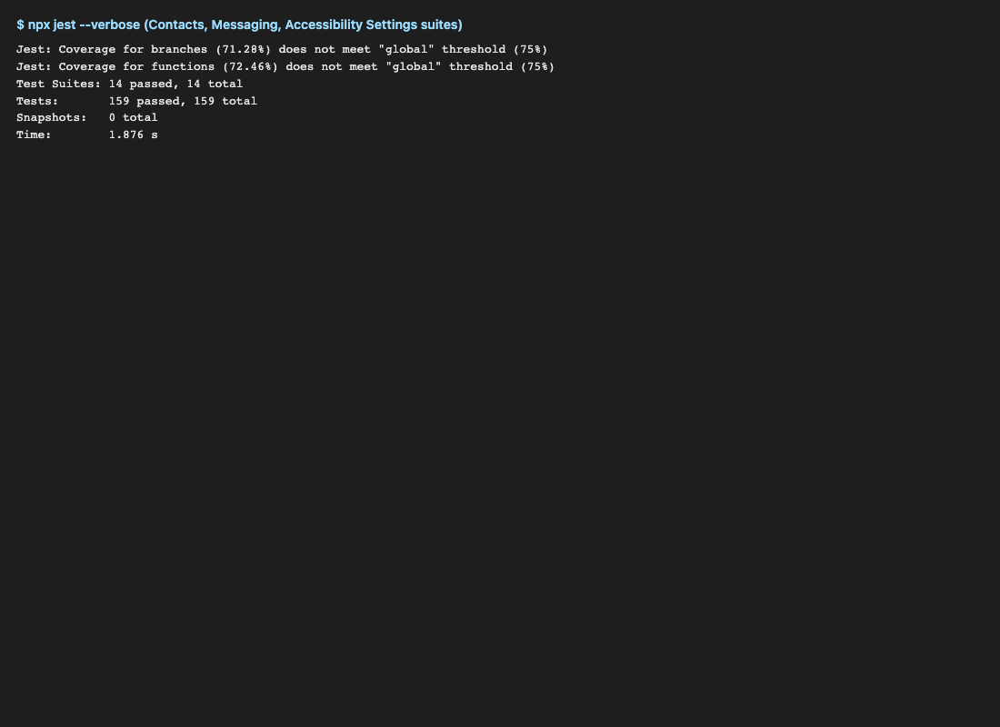
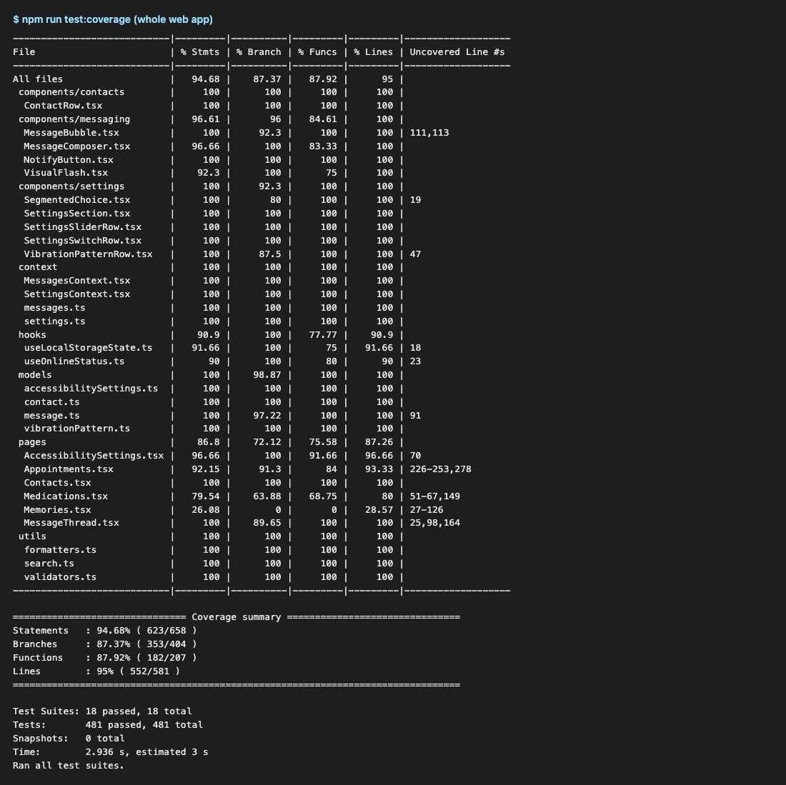

### End-to-end tests (Playwright): 5 critical flows

[`e2e/contacts-messaging.spec.ts`](../../../../e2e/contacts-messaging.spec.ts),
[`e2e/settings-keyboard.spec.ts`](../../../../e2e/settings-keyboard.spec.ts),
config in [`playwright.config.ts`](../../../../playwright.config.ts).

1. **Find → open → send → reload.** Search "son", open James, send a
   message, reload, and see it saved and shown as the preview on Contacts.
2. **Silent alert.** The worded flash appears and the written record lands in
   the conversation. Also: a voicemail shows as a transcript, and an empty
   send is refused with a reason.
3. **Offline.** `context.setOffline(true)` → the message shows "Sending" →
   back online → it is sent. With the service worker active, Contacts and a
   conversation also **open from cold while offline** (Chromium).
4. **Settings by keyboard only.** Space on a switch, Tab into the radio group,
   arrows, arrow keys on a slider, then a reload confirms everything was
   saved. The Reset dialog closes with Escape and returns focus.
5. **Settings across screens and widths.** Captions turned off → a warning
   in a conversation with a video message, which links back to Settings.
   Settings is reachable at every width, with no horizontal scroll.

```ts
// e2e/contacts-messaging.spec.ts
test('messages written offline are queued and sent when the connection returns', async ({ page, context }) => {
  await signInAsPatient(page, '/app/contacts/c3');
  await context.setOffline(true);
  await page.getByRole('textbox', { name: 'Message Maria' }).fill('Sent from the garden');
  await page.getByTestId('composer-send').click();
  const list = page.getByRole('list', { name: 'Messages with Maria' });
  await expect(list.getByText('Sending')).toBeVisible();
  await context.setOffline(false);
  await expect(list.getByText('Sending')).toBeHidden();
});
```

**Results: 25 passed, 2 skipped by design, 0 failed** across Chromium,
WebKit (Safari) and mobile Safari. The two skips are the service-worker
offline test on WebKit, where Playwright cannot emulate it reliably.

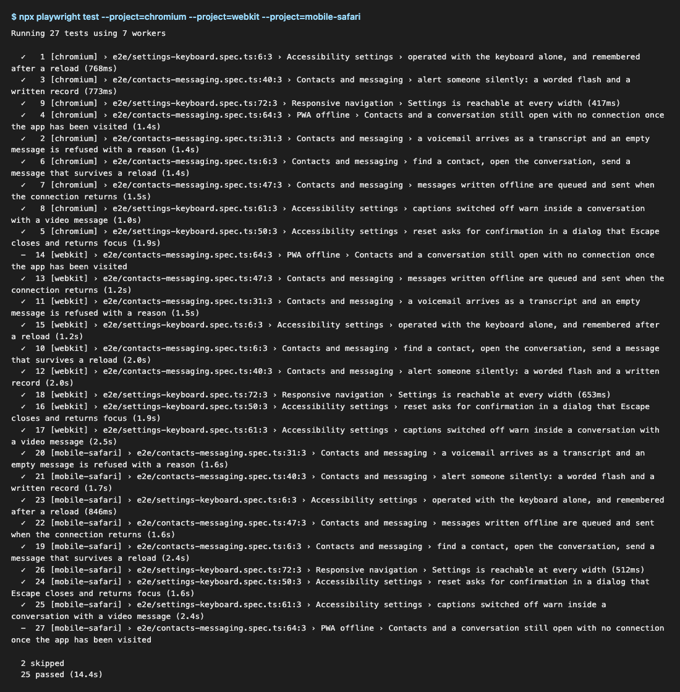
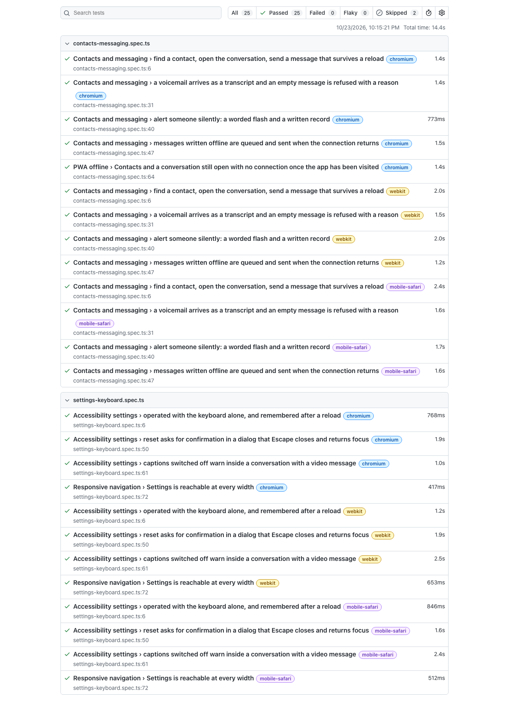

**Firefox.** The `firefox` project is configured, but Playwright's Firefox
build (v1522) hangs at launch on this development Mac (macOS 27.0.1). It
fails with `sandbox_extension_issue_file_to_process … Operation not permitted`
before any page loads, even with the sandbox turned off, so this is a local
platform problem and not an app or test failure. To still get Firefox
coverage, [`.github/workflows/web-tests.yml`](../../../../.github/workflows/web-tests.yml)
runs lint, typecheck, Jest with coverage and **all four Playwright projects,
including Firefox, on Ubuntu** for every push to `main` and every pull
request. It uploads the coverage and Playwright reports as artifacts.

### Finding the evidence in the repository

| What | Where |
|:--|:--|
| Test files | `src/**/*.test.ts(x)`, `src/models/__tests__`, `src/utils/__tests__`, `e2e/` |
| Shared render helper | `src/test-utils/renderWithProviders.tsx` |
| Screenshot scripts | `scripts/week11-victor-evidence.mjs` |

---

## 4. Coverage report

`npm run test:coverage` writes `coverage/lcov-report/index.html`, which is
committed so it can be read from the repository. Coverage is measured on the
files listed in `collectCoverageFrom` in `jest.config.cjs`, and a
`coverageThreshold` of **75%** on statements, branches, functions and lines
makes the run fail if any of them drops below that.

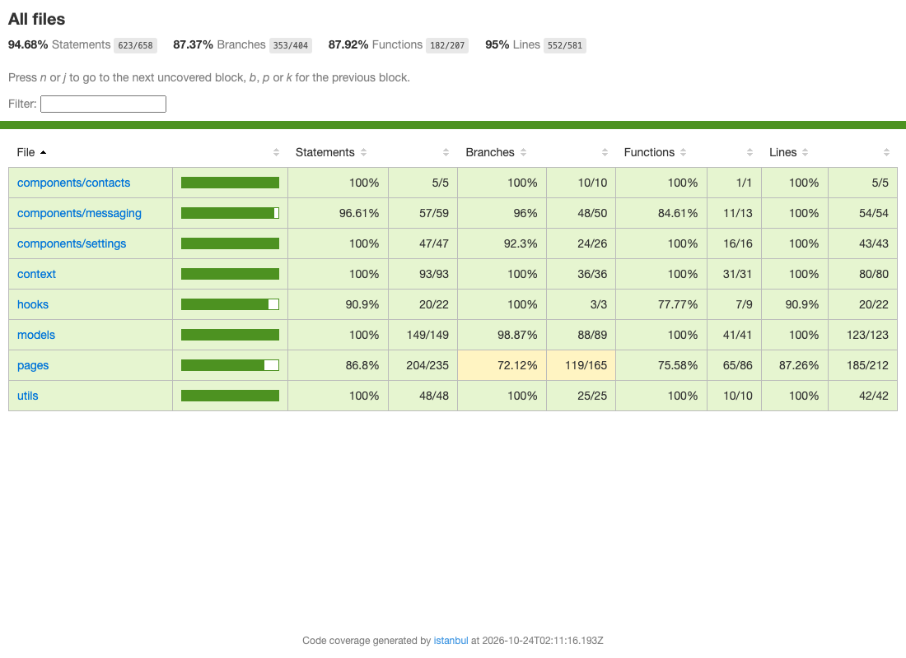

| Measured scope | Statements | Branches | Functions | Lines |
|:--|--:|--:|--:|--:|
| **All measured files** (Victor's plus the Appointments, Medicines and Memories pages already listed) | **94.68%** | **87.37%** | **87.92%** | **95.00%** |
| Contacts.tsx | 100% | 100% | 100% | 100% |
| MessageThread.tsx | 100% | 89.7% | 100% | 100% |
| AccessibilitySettings.tsx | 96.7% | 100% | 91.7% | 96.7% |
| components/contacts, messaging, settings | 96.6–100% | 92–100% | 84.6–100% | 100% |
| context, models, utils | 100% | 98.9–100% | 100% | 100% |
| hooks | 90.9% | 100% | 77.8% | 90.9% |

**Exclusions and why.**
- `src/**/__tests__/**` and `*.test.*`: test code is not measured.
- `src/data/contactsData.ts` and `messagesData.ts`: static seed data with no
  branches to test.
- `src/test-utils/`: a test helper.
- The only uncovered lines in my files are the `getServerSnapshot` fallback
  in `useOnlineStatus`, which runs only during server-side rendering (this app
  renders in the browser only), and `useLocalStorageState`'s default `revive`
  callback, which the providers always replace with their own.

---

## 6. Project links and running instructions (for my part)

```bash
npm install
npm run dev                         # http://localhost:5173 — sign in with any email, choose care recipient
npm test                            # Jest + React Testing Library
npm run test:coverage               # + coverage/lcov-report/index.html (fails under 75%)
npx playwright install chromium firefox webkit   # once
npm run test:e2e                    # builds, starts vite preview on :4173, runs every browser
npm run test:e2e -- --project=chromium           # one browser
npm run test:e2e:report             # opens the HTML report
npm run lint && npm run typecheck
```

---

## AI usage (my part)

I used Claude (Anthropic) in Claude Code as a pair programmer for this part.
It ported the existing desktop TypeScript models and screens to React with
Tailwind, drafted the component and Playwright tests, and wrote the screenshot
scripts and this write-up. I checked the output in four ways:

- Every test was run and had to pass. The coverage threshold is enforced.
- I compared the screens by eye against the 375, 768 and 1440 px screenshots.
- I ran the keyboard paths with real key presses in Playwright and `user-event`.
- I kept the failures the tests found, which led to real fixes: the
  header covering Send on mobile, and the alert flash being invisible under
  reduced motion.

`npm run lint` reports 0 errors and no new warnings, and
`npm run typecheck` is clean.

---

## Notes for the team

- **Shared files I changed:**
  - `Layout.tsx`: the header is sticky only from 768 px; the mobile header
    has a Settings link; added screen titles for Conversation and Settings.
  - `navItems.ts` and `BottomNav.tsx`: added Settings, with an
    `inBottomBar` flag.
  - `App.tsx`: added my routes, lazy-loaded, and the two providers.
  - `index.css`: flash and lamp styles.
  - `jest.config.cjs`: `.test.ts` files, `roots: ['src']` (stops Jest picking
    up `.claude/worktrees`), my files in coverage, and the 75% threshold.
  - Removed the old `Contact` type and `contacts` mock data, which only the
    old Contacts page used.
- **Coverage gap that isn't mine:** `src/pages/Memories.tsx` is at about 26%
  in the same report. It doesn't threaten the 75% total, but more tests there
  would help.
- **New dev dependencies:** `@playwright/test` and
  `@testing-library/user-event`. The new CI workflow runs Firefox, which can't
  launch locally on macOS 27.
- **Still open for whoever owns them:** the header's "Call my caregiver"
  (`tel:`) and the footer's full-page-reload `<a href="/app/contacts">`
  conflict with the no-voice-only rule and with client-side routing.
